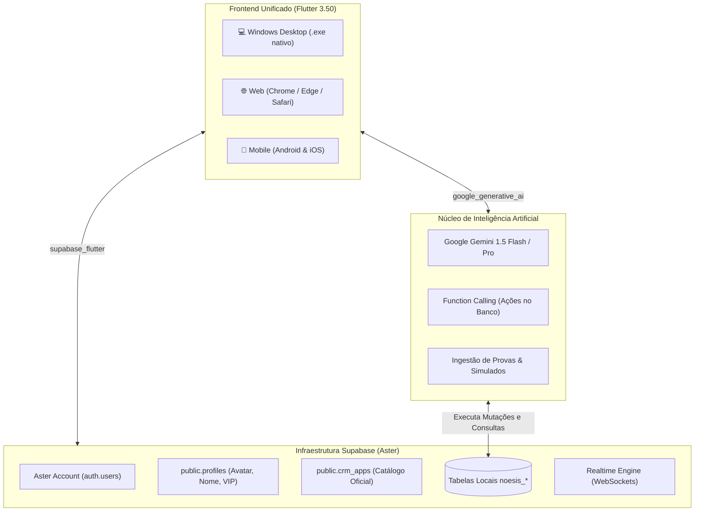

# 🏛️ Arquitetura do Sistema: Noesis (Personal OS & AI Engine)

> **Documento Oficial de Arquitetura, Modelo de Dados e Implementação Real**  
> Localização do Repositório: `C:\Users\User\Desktop\Project\Noesis`  
> Ecossistema: **Aster** (`asterdev.me`) | Status: `Implementado & Operacional`

---

## 1. Visão Geral e Propósito

O **Noesis** é o aplicativo de organização pessoal, gestão de tempo, evolução intelectual e preparação para certificações da **Aster**. Ele unifica:

1. **Tracker de Estudos & Métricas em Tempo Real**: Cronômetro ativo (Pomodoro/Stopwatch), registro manual, anotações e gráficos analíticos de horas estudadas por disciplina.
2. **Calendário Integrado**: Agendamento de provas, compromissos pessoais e blocos de estudo.
3. **Agente Autônomo com Tool Calling**: IA (Google Gemini) capaz de ler métricas, registrar estudos e agendar eventos diretamente no banco de dados.
4. **Motor de Simulados com RAG**: Geração de questões técnicas inéditas por tema livre ou **espelhadas em documentos/provas anteriores** anexadas, com prova interativa, gabarito comentado e pontuação salva no histórico.
5. **SSO Global (Aster Account)**: Autenticação única e sincronização instantânea em tempo real via Supabase.

---

## 2. Topologia e Diretrizes da Aster

Seguindo rigorosamente as diretrizes documentadas no cofre do **Obsidian** (`Instruções para IA\Ecossistema Aster`):



### 👑 Regra de Ouro Aplicada
* O banco de dados Supabase é compartilhado com todas as soluções da rede (*StudioOS*, *Soul Fighter*, *CRM*, etc.).
* **Nenhuma tabela local possui nome genérico.**
* Todas as tabelas deste produto utilizam obrigatoriamente o prefixo: **`noesis_`**.

### 👤 Aster Account & Identidade Global
* **Autenticação**: Gerenciada por `auth.users` via `supabase_flutter`.
* **Perfil do Usuário**: Lido dinamicamente de `public.profiles` (`full_name`, `@channel`, `avatar_url`, `is_vip`), sem duplicar dados localmente.
* **Catálogo CRM**: Cadastrado oficialmente na tabela `public.crm_apps` como `id: noesis`, prefixo `noesis_` e cor `#6c63ff`.

---

## 3. Esquema do Banco de Dados (PostgreSQL / Supabase)

As tabelas abaixo foram criadas, comentadas e protegidas com políticas ativas de **Row Level Security (RLS)**:

```sql
-- 1. Sessões de Estudo & Métricas
create table public.noesis_sessions (
    id uuid primary key default gen_random_uuid(),
    user_id uuid not null references auth.users(id) on delete cascade,
    subject text not null,
    topic text not null,
    duration_minutes integer not null check (duration_minutes > 0),
    study_date date not null default current_date,
    notes text,
    created_at timestamp with time zone default timezone('utc'::text, now()) not null
);

-- 2. Calendário & Agendamentos
create table public.noesis_calendar_events (
    id uuid primary key default gen_random_uuid(),
    user_id uuid not null references auth.users(id) on delete cascade,
    title text not null,
    description text,
    category text default 'study', -- 'study', 'work', 'exam', 'personal'
    start_time timestamp with time zone not null,
    end_time timestamp with time zone not null,
    is_completed boolean default false,
    created_at timestamp with time zone default timezone('utc'::text, now()) not null
);

-- 3. Documentos e Provas Anteriores para RAG
create table public.noesis_documents (
    id uuid primary key default gen_random_uuid(),
    user_id uuid not null references auth.users(id) on delete cascade,
    filename text not null,
    file_path text not null,
    file_type text not null,
    extracted_text text,
    summary text,
    created_at timestamp with time zone default timezone('utc'::text, now()) not null
);

-- 4. Simulados e Questões
create table public.noesis_quizzes (
    id uuid primary key default gen_random_uuid(),
    user_id uuid not null references auth.users(id) on delete cascade,
    document_id uuid references public.noesis_documents(id) on delete set null,
    title text not null,
    subject text not null,
    questions_data jsonb not null,
    score_percentage numeric(5,2),
    time_spent_seconds integer,
    completed_at timestamp with time zone,
    created_at timestamp with time zone default timezone('utc'::text, now()) not null
);
```

---

## 4. Estrutura de Código Implementada

O projeto foi estruturado seguindo os princípios de modularidade e separação de responsabilidades:

```
Noesis/
├── lib/
│   ├── core/
│   │   ├── constants.dart         # Tokens de cor (#6c63ff, #00cec9), chaves da Aster
│   │   ├── theme.dart             # Tema escuro oficial Aster Neo-Brutalism
│   │   ├── supabase_service.dart  # Cliente Supabase, Auth, CRUD e streams Realtime
│   │   └── gemini_service.dart    # Engine Gemini com Tool Calling e Quiz Generator
│   │
│   ├── features/
│   │   ├── auth/
│   │   │   └── auth_screen.dart        # Login Aster Account com badge de perfil
│   │   ├── tracker/
│   │   │   └── tracker_screen.dart     # Timer Pomodoro, registro, fl_chart e métricas
│   │   ├── calendar/
│   │   │   └── calendar_screen.dart    # Agenda mensal com table_calendar e categorias
│   │   ├── ai_agent/
│   │   │   └── ai_assistant_screen.dart# Chat com IA autônoma e execução de ferramentas
│   │   └── quizzes/
│   │       └── quiz_screen.dart        # Gerador RAG, prova interativa e gabarito
│   │
│   └── main.dart                  # Entrada principal com navegação adaptativa (Rail / BottomBar)
│
├── pubspec.yaml                   # Dependências (supabase, gemini, fl_chart, calendar)
└── ARQUITETURA.md                 # Este documento
```

---

## 5. Design System: Aster Neo-Brutalism

Alinhado à identidade visual encontrada em `Aster Phone OS Companion.md`:

| Token | Hex / Valor | Aplicação |
| :--- | :--- | :--- |
| **`primary`** | `#6C63FF` | Destaque principal (*Aster Accent*), botões primários e bordas de foco. |
| **`secondary`** | `#00CEC9` | *Aster Mint*, usado em badges de status, cronômetro e acertos no simulado. |
| **`bgDark`** | `#0F0F14` | Fundo principal da aplicação. |
| **`surfaceDark`** | `#171720` | Superfície da barra lateral, top bar e cards secundários. |
| **`cardDark`** | `#1E1E2C` | Superfície dos cards interativos com bordas sutis em `#2E2E42`. |
| **`accentRose`** | `#FF7675` | Indicadores de erro, prazos de provas e respostas incorretas. |
| **`accentAmber`** | `#FDCB6E` | Selo de usuário VIP da Aster Account e avisos. |

---

## 6. Como Rodar e Testar

### Pré-requisitos
* **Flutter SDK**: 3.50+ (localizado em `C:\src\flutter\bin`).

### Comandos de Execução (no PowerShell):
```powershell
# 1. Navegue até a pasta do projeto
cd "C:\Users\User\Desktop\Project\Noesis"

# 2. Rodar no navegador (Web)
flutter run -d chrome

# 3. Rodar como aplicativo Desktop no Windows
flutter run -d windows
```

> **Nota sobre o PATH no Windows**: Se o comando `flutter` não for reconhecido em um terminal que já estava aberto, feche e reabra o terminal ou execute `$env:Path = [System.Environment]::GetEnvironmentVariable("Path","Machine") + ";" + [System.Environment]::GetEnvironmentVariable("Path","User")` na sessão atual.

---

## 7. Roadmap de Próximas Evoluções

* [x] Instalação do Flutter SDK e configuração do PATH.
* [x] Criação do schema SQL com prefixo `noesis_` e políticas RLS no Supabase.
* [x] Cadastro do app no catálogo `crm_apps`.
* [x] Implementação do Tracker com Timer ativo e gráficos analíticos.
* [x] Implementação do Calendário categorizado.
* [x] Implementação do Agente de IA com Function Calling.
* [x] Implementação do Simulador de Questões com suporte a arquivos anexados.
* [ ] Adição de áudio tátil (web audio effects) nas conclusões de simulados e no timer.
* [ ] Geração do instalador `.exe` (Desktop Release) e compilação do `.apk` para Android.
