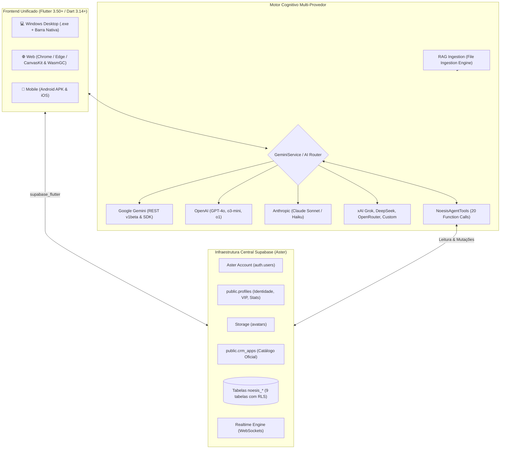

# 🏛️ Noesis — Documento Mestre de Contexto do Projeto (AI Context Guide)

> **Documento Oficial de Contexto Completo para Inteligências Artificiais e Desenvolvedores**  
> **Projeto**: Noesis (Cognitive OS & AI Study Engine)  
> **Ecossistema**: Aster (`asterdev.me`) | **Status**: Implementado & Operacional (`v1.0.0+1`)  
> **Repositório**: `C:\Users\User\Desktop\Project\Noesis` (`https://github.com/zAstergun/Noesis`)  
> **Stack Principal**: Flutter 3.50+ (Dart 3.14+), Supabase BaaS (PostgreSQL + RLS + Realtime + Storage), Multi-Provider AI (Google Gemini, OpenAI, Anthropic, xAI Grok, DeepSeek, OpenRouter, Custom REST)

---

## 1. Visão Geral e Propósito

O **Noesis** é o sistema operacional cognitivo, assistente pessoal e motor de estudos de alta performance do ecossistema **Aster**. Ele unifica em um único frontend multiplataforma (**Windows Desktop `.exe` com janela customizada**, **Android `.apk`**, **Web JS/CanvasKit & WasmGC** e **iOS**) os seguintes pilares:

1. **Tracker de Estudos & Métricas em Tempo Real (`Dashboard`)**:
   - Cronômetro ativo dual (Stopwatch contínuo e bloco Pomodoro) com `ValueNotifier<int>`.
   - Agregação de horas estudadas por disciplina, metas diária e semanal, gráficos analíticos (`fl_chart`) e heatmap de consistência diária (`CustomPainter`).
2. **Análise de Desempenho (`Desempenho`)**:
   - Diagnóstico detalhado de acurácia, volume de estudos, evolução temporal e recomendações analíticas (`PerformanceAnalyticsService`).
3. **Motor de Simulados com RAG (`Simulados`)**:
   - Geração de questões inéditas de múltipla escolha a partir de temas livres, catálogo integrado (`ExamModelsCatalog` + `exemplos_simulados/`) ou documentos anexados (`.pdf`, `.txt`, `.md`, `.json`).
   - Persistência local cross-platform (`saved_exams_store_*`) e sincronização com a nuvem (`noesis_quizzes`).
4. **Flashcards Cognitivos 3D & Importação (`Flashcards`)**:
   - Baralhos técnicos organizados por disciplina, gerador por IA, importação de arquivos (`DeckFileImporter`) e modo de estudo com *card flip* 3D e revisão espaçada (Difícil 🔴, Bom 🟡, Fácil 🟢).
5. **Cadernos de Estudo (`Cadernos`) & Trilhas (`Trilhas`)**:
   - Cadernos ricos com resumos e anotações (`noesis_study_notebooks`) e trilhas/roadmaps de aprendizado por etapas (`noesis_roadmaps`).
6. **Diário de Estudos (`Diário`) & Calendário Integrado (`Calendário`)**:
   - Histórico detalhado e registro de sessões (`StudyLogScreen`) + agenda cognitiva em 4 visões (**Dia**, **Semana**, **Mês**, **Timeline**) com categorias personalizadas e recomendações proativas da IA (`CalendarAiRecommendation`).
7. **Agente Cognitivo Autônomo com Tool Calling (`Noesis AI`)**:
   - Assistente conversacional multi-provedor com **20 ferramentas** (`NoesisAgentTools`) para ler e operar diretamente calendário, diário de estudos, metas, simulados, flashcards, cadernos e trilhas, além de suportar anexos (`NoesisAttachment`).
8. **Comunidade & Gamificação (`Grupos`, `Ranking`, `Perfil`, `Loja`)**:
   - Grupos de estudo (`noesis_study_groups`), ligas semanais com 8 Elos (`Faísca` → `Noesis`), perfil social com conquistas e cosméticos, e **Economia de Insights (`✦`)** com loja de temas, Protetores de Ofensiva e privilégios VIP (incluindo Editor RGB customizado).
9. **Autenticação Unificada (Aster Account / SSO Global) & Modo Visitante**:
   - Login/cadastro via email/senha e OAuth (Google, GitHub, Discord, Apple com loopback IO/Web), perfil compartilhado (`public.profiles`) e **Modo Visitante (`Guest Mode`)** totalmente funcional offline.
10. **Central de Configurações Multi-Provedor (`Configurações`)**:
    - Configuração de 7 provedores de IA, benchmark de latência em milissegundos, alternância entre **Aster Soft Clay (Light)**, **Dark Mode** e temas da loja, além de seletor de 15 idiomas.

---

## 2. Topologia do Ecossistema Aster e Diretrizes Mandatórias

O Noesis opera como uma das aplicações centrais da rede **Aster** (`asterdev.me`), compartilhando autenticação e perfis globais com outras soluções do ecossistema (_StudioOS_, _Soul Fighter_, _IdealCalc_, _Aster CRM_).



### 👑 Regras de Ouro Obrigatórias para Qualquer IA ou Desenvolvedor:

1. **Regra de Prefixagem Estrita**: O banco PostgreSQL do Supabase é compartilhado por toda a rede Aster. **NENHUMA tabela, view, trigger ou função criada para este projeto pode ter nome genérico.** Toda tabela do Noesis DEVE obrigatoriamente iniciar com o prefixo **`noesis_`** (ex: `noesis_sessions`, `noesis_calendar_events`, `noesis_quizzes`).
2. **Identidade Global Aster**: Não criar tabelas separadas de usuários. O usuário é identificado por `auth.users(id)` e seus dados públicos/estatísticas residem na tabela compartilhada `public.profiles` (incluindo chaves `noesis_*` no JSON de estatísticas e bucket `avatars`).
3. **Catálogo CRM Aster**: O aplicativo está registrado em `public.crm_apps` com `id: noesis`, prefixo `noesis_` e cor primária `#6c63ff` / `#7C6CF0`.
4. **Respeito ao Design System Aster Soft Clay**: Não utilizar bordas duras sólidas de alto contraste (`border: 1px solid black`), sombras secas ou paletas fora dos tokens em `lib/core/constants.dart` e `lib/core/theme.dart`.
5. **Tolerância a Falhas / Modo Offline (`Modo Visitante`)**: Qualquer tela ou repositório deve possuir fallback in-memory / store local limpo para funcionar perfeitamente sem conexão ativa ou sem login (`currentUser == null`).

---

## 3. Esquema do Banco de Dados (PostgreSQL / Supabase)

Todas as tabelas locais são protegidas com **Row Level Security (RLS)** vinculadas a `auth.uid() = user_id` (ou políticas de grupo em `noesis_study_groups`).

### Tabelas Ativas no Projeto (`noesis_*`):

| Tabela | Responsabilidade | Módulo Principal |
| :--- | :--- | :--- |
| **`public.noesis_sessions`** | Sessões de estudo cronometradas e manuais | `tracker`, `study_log`, `supabase_service.dart` |
| **`public.noesis_calendar_events`** | Blocos de foco, revisões, labs e provas | `calendar`, `supabase_service.dart` |
| **`public.noesis_documents`** | Documentos e provas anteriores ingeridos para RAG | `quizzes`, `supabase_service.dart` |
| **`public.noesis_quizzes`** | Simulados gerados, questões JSONB, acurácia e tempo | `quizzes`, `saved_exams_repository.dart` |
| **`public.noesis_flashcard_decks`** | Baralhos e cartões de revisão espaçada 3D | `flashcards`, `supabase_service.dart` |
| **`public.noesis_study_notebooks`** | Cadernos e anotações de estudo | `notebooks`, `supabase_service.dart` |
| **`public.noesis_roadmaps`** | Trilhas de aprendizado e etapas | `roadmaps`, `roadmaps_repository.dart` |
| **`public.noesis_study_groups`** | Grupos colaborativos de estudo | `study_groups`, `study_groups_service.dart` |
| **`public.noesis_insight_ledger`** | Razão contábil da Economia de Insights (`✦`) | `shop`, `shop_service.dart` |

### Definição Base das 4 Tabelas Centrais:

```sql
-- 1. SESSÕES DE ESTUDO & MÉTRICAS (noesis_sessions)
create table public.noesis_sessions (
    id uuid primary key default gen_random_uuid(),
    user_id uuid not null references auth.users(id) on delete cascade,
    subject text not null,
    topic text not null,
    duration_minutes integer not null check (duration_minutes > 0),
    study_date date not null default current_date,
    notes text,
    created_at timestamp with time zone default timezone('utc'::text, now()) not null
);

-- 2. CALENDÁRIO, BLOCOS DE FOCO E AGENDAMENTOS (noesis_calendar_events)
create table public.noesis_calendar_events (
    id uuid primary key default gen_random_uuid(),
    user_id uuid not null references auth.users(id) on delete cascade,
    title text not null,
    description text,
    category text default 'study', -- 'study', 'review', 'lab', 'exam', 'personal'
    color text,                    -- Hex string opcional (ex: '#7C6CF0')
    start_time timestamp with time zone not null,
    end_time timestamp with time zone not null,
    is_completed boolean default false,
    created_at timestamp with time zone default timezone('utc'::text, now()) not null
);

-- 3. DOCUMENTOS E PROVAS ANTERIORES PARA RAG (noesis_documents)
create table public.noesis_documents (
    id uuid primary key default gen_random_uuid(),
    user_id uuid not null references auth.users(id) on delete cascade,
    filename text not null,
    file_path text not null,
    file_type text not null,
    extracted_text text,
    summary text,
    created_at timestamp with time zone default timezone('utc'::text, now()) not null
);

-- 4. SIMULADOS GERADOS E RESULTADOS (noesis_quizzes)
create table public.noesis_quizzes (
    id uuid primary key default gen_random_uuid(),
    user_id uuid not null references auth.users(id) on delete cascade,
    document_id uuid references public.noesis_documents(id) on delete set null,
    title text not null,
    subject text not null,
    questions_data jsonb not null,
    score_percentage numeric(5,2),
    time_spent_seconds integer,
    completed_at timestamp with time zone,
    created_at timestamp with time zone default timezone('utc'::text, now()) not null
);
```

---

## 4. Design System Oficial: Aster Soft Clay, Dark Mode & Temas

O Noesis segue o estilo **Aster Soft Clay** (argila suave), com cantos orgânicos amplos, zero bordas secas, sombras difusas multicamada e zoneamento quadricromático semântico.

### Tokens de Cor e Semântica (`AsterConstants` em `lib/core/constants.dart`):

| Token                      | Hex / Valor | Função Semântica                  | Aplicação no Sistema                                                |
| :------------------------- | :---------- | :-------------------------------- | :------------------------------------------------------------------ |
| **`bgNevoa` / `bgCanvas`** | `#EEF0F8`   | Fundo ambiente suave              | Canvas geral da aplicação com iluminação suave.                     |
| **`surfaceCard`**          | `#FFFFFF`   | Superfície primária elevada       | Cards flutuantes com zero bordas e raio de 28px.                    |
| **`surfaceAlt`**           | `#F3F4FB`   | Superfície secundária suave       | Campos de busca, cards internos, inputs e badges passivos.          |
| **`surfaceInset`**         | `#E6E8F3`   | Superfície de rebaixo             | Fundo de trilhas de progresso e células vazias do heatmap.          |
| **`lavanda`**              | `#7C6CF0`   | Ação primária, foco e estudo      | Botões de ação, timer ativo, logo Noesis e categoria Estudo.        |
| **`menta`**                | `#3CCF9A`   | Revisão, constância e sucesso     | Heatmap de consistência, badges de acerto e categoria Revisão.      |
| **`ambar`**                | `#F5A623`   | Laboratórios práticos e metas     | Alertas de meta semanal, simulados RAG e categoria Lab.             |
| **`coral`**                | `#FF7A90`   | Provas oficiais, prazos e alertas | Prazos de exames, questões erradas, notificações e categoria Prova. |
| **`textDark`**             | `#23233A`   | Tipografia de alto contraste      | Títulos, numerais e leitura sem a agressividade do preto puro.      |
| **`textMuted`**            | `#6F7190`   | Tipografia secundária             | Metadados, descrições auxiliares e rótulos de métricas.             |
| **`textFaint`**            | `#A7A9C2`   | Elementos inativos e placeholders | Dicas em campos de texto e ícones secundários passivos.             |

### Dark Mode & Temas Desbloqueáveis (`AsterTheme` + `ShopService`):

- **Dark Mode Canônico**: `bgDark` (`#11121C`), `surfaceCardDark` (`#1B1C2A`), `surfaceAltDark` (`#24263A`), `surfaceInsetDark` (`#2E3149`), `textLight` (`#F4F5FB`), `textMutedDark` (`#989BB8`), `textFaintDark` (`#656888`), controlado por `AsterTheme.themeModeNotifier` com transição de `280ms` (`Curves.easeInOutCubic`).
- **Temas da Loja (`InsightsEconomyConfig.themePrices`)**: `soft_clay_nevoa` (grátis), `aurora`, `floresta`, `oceano` (300 ✦), `brasa`, `lagoa`, `sakura`, `nordico` (600 ✦), `grafite`, `esmeralda`, `crepusculo` (1000 ✦), além do **Tema VIP Customizável** com editor RGB em tempo real (`VipRgbThemeEditor`).
- **Raios & Sombras**: `radiusLarge = 28.0`, `radiusMedium = 16.0`, `radiusPill = 999.0`; sombras `clayShadow`, `claySubtleShadow`, `clayListShadow`, `clayDarkShadow`, `clayListDarkShadow`, `claySubtleDarkShadow`, `primaryButtonShadow`.
- **Tipografia Local Offline (`assets/fonts/`)**: 10 arquivos `.ttf` empacotados localmente (`Manrope` 5 pesos, `JetBrainsMono` 4 pesos e `SpaceGrotesk-Bold.ttf`) com `GoogleFonts.config.allowRuntimeFetching = false`.

---

## 5. Estrutura do Código e Arquitetura de Pastas

O projeto adota arquitetura modular orientada a funcionalidades (_feature-first_), com infraestrutura compartilhada em `lib/core/` e componentes visuais em `lib/widgets/`:

```text
c:\Users\User\Desktop\Project\Noesis\
├── .vscode/                      # Configurações de IDE e ambiente
├── assets/
│   ├── fonts/                    # 10 fontes locais TTF (Manrope, JetBrainsMono, SpaceGrotesk)
│   └── images/                   # Logotipo SVG e ícone de Insights (logo.svg, insight.svg)
├── docs/
│   ├── screenshots/              # Capturas oficiais (Aster Soft Clay Desktop & Mobile)
│   ├── ARQUITETURA.md            # Documento inicial de arquitetura e topologia
│   └── PERFORMANCE_REPORT.md     # Auditoria de performance Web / WasmGC
├── exemplos_simulados/           # Catálogo de simulados e exames de referência
├── releases/                     # Binários oficiais versionados (Android APK & Windows ZIP)
├── scripts/                      # Utilitários de empacotamento (package_releases.ps1)
├── lib/
│   ├── core/
│   │   ├── audio_service.dart           # Efeitos sonoros táteis (audioplayers)
│   │   ├── constants.dart               # Tokens Aster Soft Clay, cores, raios e URLs Supabase
│   │   ├── desktop_window_service.dart  # Controle da janela nativa Windows (MethodChannel)
│   │   ├── gemini_service.dart          # Hub multi-IA, fetch de modelos, Tool Calling e RAG
│   │   ├── insights_economy_config.dart # Regras da moeda Insights (✦), caps, Elos e preços
│   │   ├── noesis_agent_tools.dart      # 20 declarações de ferramentas, anexos e executor
│   │   ├── notifications_service.dart   # Central e fila de notificações
│   │   ├── oauth_loopback_io.dart       # Servidor loopback OAuth para Desktop/Mobile
│   │   ├── oauth_loopback_stub.dart     # Stub OAuth para Web
│   │   ├── shop_service.dart            # Economia, temas equipados, Protetores de Ofensiva e VIP
│   │   ├── supabase_service.dart        # Cliente Supabase, Auth, CRUD e Streams Realtime
│   │   ├── theme.dart                   # Temas Claro/Escuro e temas desbloqueáveis
│   │   └── tts/                         # Síntese de voz (tts_helper, tts_stub, tts_web)
│   │
│   ├── features/
│   │   ├── ai_agent/                    # Noesis AI + histórico persistente de conversas
│   │   ├── auth/                        # Aster Account SSO, OAuth e Modo Visitante
│   │   ├── calendar/                    # Agenda 4 vistas (Dia/Sem/Mês/Timeline) + sugestões IA
│   │   ├── flashcards/                  # Hub de baralhos, importador de arquivos e flip 3D
│   │   ├── notebooks/                   # Cadernos de estudo e anotações
│   │   ├── performance/                 # Análises de desempenho e evolução
│   │   ├── profile/                     # Perfil social, seguidores, conquistas e cosméticos
│   │   ├── quizzes/                     # Simulados RAG, ExamModelsCatalog e stores locais
│   │   ├── ranking/                     # Ranking semanal e sistema de 8 Elos
│   │   ├── roadmaps/                    # Trilhas de aprendizado estruturadas
│   │   ├── settings/                    # Provedores IA, benchmark de latência, tema e 15 idiomas
│   │   ├── shop/                        # Loja de temas, Arsenal de Estudo e privilégios VIP
│   │   ├── study_groups/                # Grupos de estudo colaborativos e modais
│   │   ├── study_log/                   # Diário de Estudos detalhado
│   │   └── tracker/                     # Timer Pomodoro/Stopwatch, analytics e heatmap
│   │
│   ├── widgets/
│   │   ├── country_flag_icon.dart       # Bandeiras para seletor de idiomas
│   │   ├── desktop_top_bar.dart         # Barra superior desktop com controles de janela e busca
│   │   ├── insight_gain_toast_overlay.dart # Toast animado de ganho de Insights
│   │   ├── insight_icon.dart            # Ícone oficial da moeda Insights
│   │   ├── noesis_logo.dart             # Marca vetorial do Noesis
│   │   ├── profile_settings_dialog.dart # Edição de perfil e avatar
│   │   ├── vip_privileges.dart          # Regras e selos VIP
│   │   ├── vip_rgb_theme_editor.dart    # Editor de tema customizado RGB para VIP
│   │   └── weekly_goal_dialog.dart      # Configurador de meta semanal
│   │
│   └── main.dart                        # Shell adaptativo (14 abas, Sidebar/DesktopTopBar/BottomBar)
│
├── test/                         # Suíte de testes unitários, widgets e E2E (Tiers 1–4)
├── pubspec.yaml                  # Dependências, fontes e declaração de assets
├── README.md                     # Visão geral, screenshots e downloads oficiais
└── PROJECT_CONTEXT.md            # Este documento oficial de contexto para IA
```

---

## 6. Módulos e Funcionalidades Detalhadas

### 6.1 Shell Adaptativo & Janela Desktop (`lib/main.dart`, `lib/widgets/desktop_top_bar.dart`)

O `RootScreen` gerencia **14 abas lazy-loaded** em `Offstage` + `TickerMode` + `RepaintBoundary` via `ValueNotifier<int>` (`_activeTabNotifier`), organizadas em 5 seções na Sidebar Desktop:
- **Principal**: `Dashboard` (0 - `TrackerScreen`), `Desempenho` (13 - `PerformanceScreen`)
- **ESTUDO**: `Simulados` (1 - `QuizScreen`), `Flashcards` (2 - `FlashcardsScreen`), `Cadernos` (3 - `NotebooksScreen`), `Trilhas` (8 - `RoadmapsScreen`)
- **ROTINA & IA**: `Diário de Estudos` (7 - `StudyLogScreen`), `Calendário` (5 - `CalendarScreen`), `Noesis AI` (4 - `AiAssistantScreen`)
- **COMUNIDADE**: `Grupos` (10 - `StudyGroupsScreen`), `Ranking` (11 - `RankingScreen`)
- **CONTA**: `Perfil` (12 - `ProfileScreen`), `Loja` (9 - `ShopScreen`), `Configurações` (6 - `SettingsScreen`)

- **Desktop / Windows Nativo**: `DesktopTopBar` integrada com `DesktopWindowService` (`MethodChannel('noesis/window_controls')` para arrasto, minimizar, maximizar/restaurar, fechar e sincronia com modo escuro), carteira de Insights, notificações e avatar.
- **Mobile (< 900px)**: Barra de navegação inferior fixa com 4 destinos primários (`{0, 1, 2, 4}`: Início, Simulados, Flashcards, Noesis AI) + **Menu Hub** para acessar todas as demais abas.

### 6.2 Autenticação & Identidade Aster (`lib/features/auth/auth_screen.dart`)

- Login e cadastro com `auth.users` e `public.profiles`.
- Recuperação de senha (`resetPasswordForEmail`) e provedores OAuth (Google, GitHub, Discord, Apple) com loopback HTTP em plataformas nativas (`oauth_loopback_io.dart`).
- **Modo Visitante (`Guest Mode`)**: acesso imediato offline com dados mockados e armazenamento local em memória sem exigir cadastro.

### 6.3 Tracker, Diário de Estudos & Desempenho (`tracker/`, `study_log/`, `performance/`)

- Timer de alta precisão (`HH:MM:SS`) via `ValueNotifier<int>` (Stopwatch e Pomodoro), meta semanal e diária configuráveis (`weekly_goal_dialog.dart`), gráfico de distribuição (`fl_chart`), heatmap `CustomPainter` e histórico sincronizado em `noesis_sessions`.
- `StudyLogScreen` dedica-se à consulta e manutenção detalhada das sessões; `PerformanceScreen` consolida métricas de evolução e retenção.

### 6.4 Calendário Cognitivo (`lib/features/calendar/calendar_screen.dart`)

- 4 modos de visualização (**Dia**, **Semana**, **Mês** com `table_calendar` e **Timeline**), categorias padrão (`study`, `review`, `lab`, `exam`, `personal`) e personalizadas, sugestão inteligente da IA (`CalendarAiRecommendation`) e exclusão otimista com "Desfazer".

### 6.5 Simulados RAG & Catálogo de Exames (`lib/features/quizzes/`)

- Catálogo oficial `ExamModelsCatalog` + arquivos de referência em `exemplos_simulados/` (vestibulares Brasil, internacionais, idiomas, tecnologia/certificações, jurídico/concursos, saúde/medicina, negócios/economia).
- Ingestão de documentos para RAG (`.pdf`, `.txt`, `.md`, `.json`), snippets de código, marcação para revisão (_flag_), cronômetro regressivo, gabarito comentado com fontes RAG e armazenamento local (`saved_exams_store_*`) + nuvem (`noesis_quizzes`).

### 6.6 Flashcards 3D, Cadernos & Trilhas (`flashcards/`, `notebooks/`, `roadmaps/`)

- **Flashcards**: geração via IA, importação de baralhos (`DeckFileImporter`), revisão 3D com `Transform`/`Matrix4` e avaliação espaçada, integrando recompensas de Insights quando revisados no prazo.
- **Cadernos**: editor e organização de anotações persistidas em `noesis_study_notebooks`.
- **Trilhas**: roadmaps de aprendizado por objetivo e semanas estimadas em `noesis_roadmaps`.

### 6.7 Agente Cognitivo Noesis AI (`lib/features/ai_agent/`)

- Chat com renderização Markdown (`flutter_markdown`), histórico persistido (`AiChatHistoryRepository`), chips de sugestão rápida (`NoesisQuickSuggestion`), suporte a anexos (`NoesisAttachment`: arquivo, simulado, caderno, baralho, trilha, diário, calendário) e execução autônoma de **20 ferramentas** em `NoesisAgentTools`.

### 6.8 Comunidade, Ranking, Perfil & Economia de Insights (`study_groups/`, `ranking/`, `profile/`, `shop/`)

- **Ranking**: Ligas semanais com 8 Elos progressivos (`Faísca`, `Vigília`, `Logos`, `Síntese`, `Episteme`, `Ápice`, `Sophia`, `Noesis`), conferindo +10% de ganho de Insights e +20 no teto diário por Elo.
- **Perfil Social**: conexões (`SocialConnectionsService`), conquistas (`profile_achievements.dart`), cosméticos (`profile_cosmetics.dart`) e modal de perfil público.
- **Loja & Economia (`InsightsEconomyConfig` + `ShopService`)**: moeda **Insights (`✦`)** ganha por esforço real (questões ≥ 3s, revisões devidas, simulados, metas e marcos de streak), regras anti-abuso, teto diário suave (`150` base), multiplicador VIP `2×`, Protetores de Ofensiva (máx. `5` padrão / `10` VIP) e 10 temas desbloqueáveis + editor RGB VIP.

### 6.9 Central de Configurações (`lib/features/settings/settings_screen.dart`)

- Alternância entre Modo Claro (*Aster Soft Clay*), Modo Escuro e temas equipados.
- Seleção de provedor e modelo de IA, teste de conexão com **benchmark de latência** em milissegundos e seletor de **15 idiomas** com bandeiras (`CountryFlagIcon`).

---

## 7. Motor de Inteligência Artificial & Tool Calling (`gemini_service.dart` & `noesis_agent_tools.dart`)

O `GeminiService` roteia chamadas entre o endpoint REST `v1beta` do Google Gemini (incluindo descoberta dinâmica de modelos operacionais via `fetchOperationalGoogleModels`) e endpoints compatíveis com OpenAI/Anthropic.

### 7.1 Catálogo de Provedores e Modelos Configurados (`GeminiService.providers`):

1. **Google Gemini (`google`)**: `gemini-flash-lite-latest` (padrão), `gemini-3-flash-preview`, `gemini-3.5-flash-lite`, `gemini-2.5-flash`, `gemini-2.0-flash`.
2. **OpenAI (`openai`)**: `gpt-4o`, `gpt-4o-mini` (padrão), `o3-mini`, `o1`.
3. **Anthropic (`anthropic`)**: `claude-3-7-sonnet` (padrão), `claude-3-5-haiku`, `claude-3-5-sonnet`.
4. **xAI · Grok (`xai`)**: `grok-2-1212` (padrão), `grok-2-vision-1212`, `grok-beta`.
5. **DeepSeek (`deepseek`)**: `deepseek-chat` (padrão), `deepseek-reasoner`.
6. **OpenRouter (`openrouter`)**: `auto` (padrão), `google/gemini-1.5-flash`, `deepseek/deepseek-chat`, `anthropic/claude-3.7-sonnet`.
7. **Personalizado (`custom`)**: URL base configurável compatível com `/chat/completions`.

### 7.2 Ferramentas Declaradas (`NoesisAgentTools.googleRestFunctionDeclarations`):

1. **Leitura / Inspeção**: `inspect_account_data` (`all`, `calendar`, `sessions`, `quizzes`, `flashcards`, `notebooks`, `roadmaps`, `weekly_goal`).
2. **Calendário**: `schedule_calendar_event`, `update_calendar_event`, `delete_calendar_event`.
3. **Diário & Metas**: `log_study_session`, `update_study_session`, `delete_study_session`, `set_weekly_goal`, `set_daily_goal`.
4. **Simulados & Flashcards**: `create_quiz`, `delete_quiz`, `create_flashcards`, `update_flashcard_deck`, `delete_flashcard_deck`.
5. **Cadernos & Trilhas**: `create_notebook_or_note`, `update_notebook_or_note`, `delete_notebook_or_note`, `create_roadmap`, `update_roadmap`, `delete_roadmap`.

Provedores sem Function Calling nativo também contam com parser de fallback para blocos `<noesis_action>...</noesis_action>`.

---

## 8. Como Rodar, Compilar, Empacotar e Testar

### Pré-requisitos

- **Flutter SDK**: `3.50+`
- **Dart SDK**: `3.14+`
- **Visual Studio C++ Desktop Tools** (para build nativo Windows) e **Android SDK** (para build APK).

### Comandos Principais (PowerShell):

```powershell
# 1. Instalar dependências
flutter pub get

# 2. Executar em desenvolvimento (Web / Windows / Android)
flutter run -d chrome
flutter run -d windows
flutter run -d android

# 3. Análise estática e testes
flutter analyze
flutter test

# 4. Compilar builds de produção
flutter build apk --release
flutter build windows --release
flutter build web --release
flutter build web --release --wasm

# 5. Atualizar pacotes oficiais na pasta releases/
.\scripts\package_releases.ps1 -Version "1.0.0"
```

### Performance Web & Otimizações Implementadas

A versão Web (JS/CanvasKit e **WasmGC** / SkWasm) passou por auditoria completa documentada em `docs/PERFORMANCE_REPORT.md`:

1. **Fontes 100% Locais Offline**: arquivos `.ttf` em `assets/fonts/` com `allowRuntimeFetching = false`.
2. **Sombras Soft Clay Otimizadas (`clayListShadow`)**: redução de camadas de blur na GPU em listas densas.
3. **Heatmap com `CustomPainter`**: canvas único de alta performance sem centenas de `RenderObject`s.
4. **Isolamento com `RepaintBoundary`, `Offstage` e `TickerMode`**: evita rebuilds/repaints em cascata entre as 14 abas e gráficos (`fl_chart`, `TableCalendar`).
5. **Reatividade Granular com `ValueNotifier` & Streams `.distinct()`**: elimina `setState()` na raiz durante cronômetros e trocas de aba.
6. **Background Isolates (`compute`) & Modo Visitante In-Memory**: parsing RAG/JSON fora da thread principal e operação fluida sem rede ou login.

---

## 9. Guia Prático para IAs: Como Estender ou Modificar o Projeto

1. **Novas tabelas no Supabase**:
   - Use sempre o prefixo **`noesis_`** e vincule `user_id uuid references auth.users(id) on delete cascade` com RLS ativo (`auth.uid() = user_id`).
2. **Serviços e Resiliência Offline**:
   - Centralize chamadas base em `lib/core/supabase_service.dart` (ou serviço da feature) sempre mantendo fallback seguro para `currentUser == null` (Modo Visitante).
3. **Design System Aster Soft Clay**:
   - Utilize tokens de `AsterConstants` e `AsterTheme` (`lavanda`, `menta`, `ambar`, `coral`, `surfaceCard`, `surfaceAlt`, `clayShadow`, `radiusLarge`, `radiusPill`), respeitando também os temas desbloqueáveis da loja e Dark Mode.
4. **Performance & UI**:
   - Prefira `ValueNotifier`/`ValueListenableBuilder` para timers e estados frequentes, e `RepaintBoundary` ao redor de áreas animadas ou gráficos.
5. **Sincronia de Documentação e Releases**:
   - Ao adicionar módulos, ferramentas em `NoesisAgentTools` ou alterar a estrutura de pastas, atualize `PROJECT_CONTEXT.md` e `README.md`; ao gerar novos binários de distribuição, atualize `releases/` via `scripts/package_releases.ps1`.

---

_Este documento é a referência definitiva sobre a arquitetura, modelo de dados e decisões de design do Noesis. Mantenha-o sempre atualizado após modificações estruturais no projeto._
