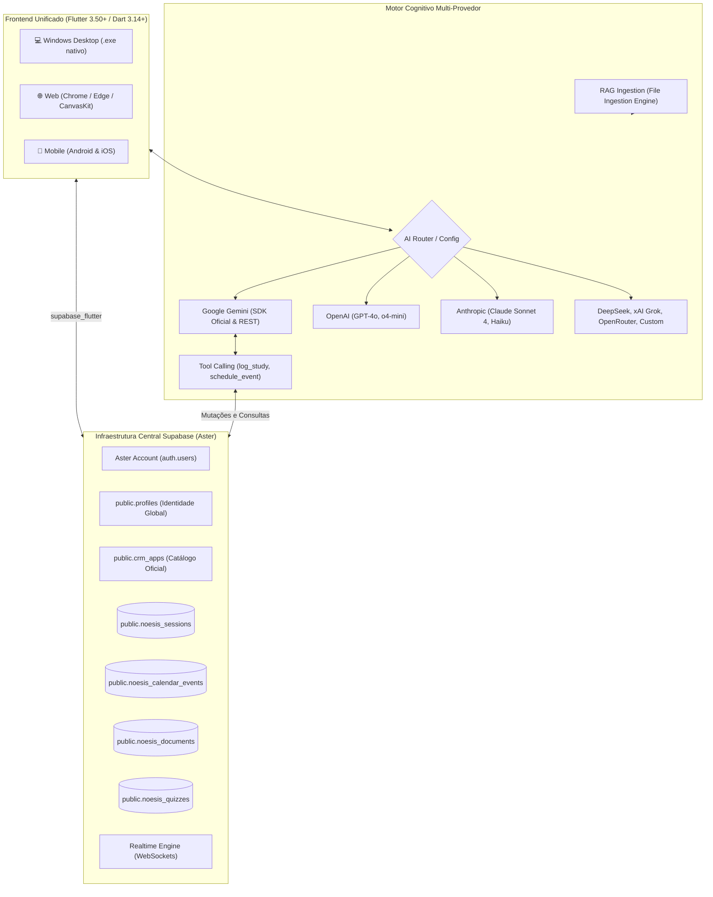

# 🏛️ Noesis — Documento Mestre de Contexto do Projeto (AI Context Guide)

> **Documento Oficial de Contexto Completo para Inteligências Artificiais e Desenvolvedores**  
> **Projeto**: Noesis (Cognitive OS & AI Study Engine)  
> **Ecossistema**: Aster (`asterdev.me`) | **Status**: Implementado & Operacional  
> **Repositório**: `C:\Users\User\Desktop\Project\Noesis`  
> **Stack Principal**: Flutter 3.50+ (Dart 3.14+), Supabase BaaS (PostgreSQL + RLS + Realtime), Multi-Provider AI (Google Gemini, OpenAI, Anthropic, DeepSeek, xAI, OpenRouter, Custom REST)

---

## 1. Visão Geral e Propósito

O **Noesis** é o sistema operacional cognitivo, assistente pessoal e motor de estudos de alta performance do ecossistema **Aster**. Ele foi concebido para resolver de forma unificada os principais pilares da rotina de estudantes, engenheiros de software e candidatos a certificações técnicas de alto nível (como CompTIA Security+, AWS Solutions Architect, Kubernetes CKA e OWASP Top 10):

1. **Tracker de Estudos & Métricas em Tempo Real**:
   - Cronômetro ativo dual (Stopwatch contínuo e bloco Pomodoro).
   - Agregação automática de horas estudadas por disciplina e tópicos.
   - Gráficos analíticos (`fl_chart`) com distribuição percentual por matéria, metas semanais e heatmap de consistência diária (estilo GitHub/Obsidian).
2. **Calendário Integrado & Agenda Cognitiva**:
   - Planejamento de blocos de foco, revisões espaçadas, laboratórios e provas oficiais.
   - Quatro modos de visualização: **Dia**, **Semana**, **Mês** e **Timeline**.
   - Categorias personalizáveis com paleta semântica e ícones dinâmicos.
   - Sugestões inteligentes da IA (com agendamento em 1 clique) e exclusão com feedback otimista e botão "Desfazer".
3. **Agente Cognitivo Autônomo com Tool Calling**:
   - Assistente inteligente conversacional integrado com capacidade de executar ações reais no banco de dados.
   - Ferramentas ativas (*Function Calling*): registrar sessões de estudo (`log_study_session`) e agendar eventos no calendário (`schedule_calendar_event`).
   - Modal com atalhos de comando por voz e predefinições rápidas.
4. **Motor de Simulados com RAG (Retrieval-Augmented Generation)**:
   - Geração de questões inéditas de múltipla escolha com base em temas livres, presets de bancas examinadoras ou **documentos e provas anteriores anexados** (`.pdf`, `.txt`, `.md`, `.json`).
   - Interface de prova completa: contagem regressiva, snippets de código formatados com fonte monoespaçada, marcação de questões para revisão (*flag*), gabarito interativo com justificativas detalhadas e citação das fontes RAG.
   - Persistência automática do score, tempo gasto e histórico na nuvem.
5. **Autenticação Unificada (Aster Account / SSO Global)**:
   - Login e cadastro via email/senha, suporte a OAuth (Discord, Google, GitHub, Apple).
   - Perfil dinâmico sincronizado com a rede Aster (`public.profiles`).
   - Modo Visitante / Demonstração (*Guest Mode*) totalmente funcional para testes offline ou sem login imediato.
6. **Central de Configurações Multi-Provedor**:
   - Suporte nativo a múltiplos provedores de IA: Google Gemini, OpenAI, Anthropic, xAI (Grok), DeepSeek, OpenRouter e Endpoints personalizados (OpenAI-compatible).
   - Ferramenta de benchmark de latência da chave de API em milissegundos.
   - Alternância de tema entre **Aster Soft Clay (Light)** e **Dark Mode**.
   - Seletor de 15 idiomas do ecossistema internacional.

---

## 2. Topologia do Ecossistema Aster e Diretrizes Mandatórias

O projeto Noesis opera como uma das aplicações centrais da rede **Aster** (`asterdev.me`), coexistindo no mesmo banco de dados com outras soluções do ecossistema (*StudioOS*, *Soul Fighter*, *IdealCalc*, *Aster CRM*).



### 👑 Regras de Ouro Obrigatórias para Qualquer IA ou Desenvolvedor:
1. **Regra de Prefixagem Estrita**: O banco PostgreSQL do Supabase é compartilhado por toda a rede Aster. **NENHUMA tabela, view, trigger ou função criada para este projeto pode ter nome genérico.** Toda tabela do Noesis DEVE obrigatoriamente iniciar com o prefixo: **`noesis_`** (ex: `noesis_sessions`, `noesis_calendar_events`, `noesis_quizzes`).
2. **Identidade Global Aster**: Não criar tabelas separadas de usuários ou perfis no Noesis. O usuário é identificado por `auth.users(id)` e seus dados visuais públicos (`full_name`, `channel`, `avatar_url`, `is_vip`) residem na tabela compartilhada `public.profiles`.
3. **Catálogo CRM Aster**: O aplicativo está registrado em `public.crm_apps` com a chave `id: noesis`, prefixo `noesis_` e cor primária `#6c63ff`.
4. **Respeito ao Design System Aster Soft Clay**: Não utilizar botões quadrados, bordas duras sólidas de alto contraste (`border: 1px solid black`), sombras secas ou paletas fora dos tokens semânticos definidos em `lib/core/constants.dart`.
5. **Tolerância a Falhas / Modo Offline**: Qualquer tela do sistema deve possuir fallback in-memory ou mock de visualização limpo para que o aplicativo possa ser demonstrado e utilizado perfeitamente mesmo sem conexão ativa ou em modo convidado (`_isGuestMode`).

---

## 3. Esquema do Banco de Dados (PostgreSQL / Supabase)

O banco de dados é hospedado no Supabase oficial da Aster. Abaixo está a definição completa das tabelas locais com suas restrições e políticas de segurança:

```sql
-- =============================================================================
-- 1. SESSÕES DE ESTUDO & MÉTRICAS (noesis_sessions)
-- =============================================================================
create table public.noesis_sessions (
    id uuid primary key default gen_random_uuid(),
    user_id uuid not null references auth.users(id) on delete cascade,
    subject text not null,
    topic text not null,
    duration_minutes integer not null check (duration_minutes > 0),
    study_date date not null default current_date,
    notes text,
    created_at timestamp with time zone default timezone('utc'::text, now()) not null
);

-- Políticas RLS
alter table public.noesis_sessions enable row level security;
create policy "Usuários podem gerenciar suas próprias sessões"
    on public.noesis_sessions
    for all
    using (auth.uid() = user_id)
    with check (auth.uid() = user_id);

-- =============================================================================
-- 2. CALENDÁRIO, BLOCOS DE FOCO E AGENDAMENTOS (noesis_calendar_events)
-- =============================================================================
create table public.noesis_calendar_events (
    id uuid primary key default gen_random_uuid(),
    user_id uuid not null references auth.users(id) on delete cascade,
    title text not null,
    description text,
    category text default 'study', -- 'study', 'review', 'lab', 'exam', 'personal'
    color text,                    -- Hex string opcional (ex: '#7C6CF0')
    start_time timestamp with time zone not null,
    end_time timestamp with time zone not null,
    is_completed boolean default false,
    created_at timestamp with time zone default timezone('utc'::text, now()) not null
);

-- Políticas RLS
alter table public.noesis_calendar_events enable row level security;
create policy "Usuários podem gerenciar seus próprios eventos de calendário"
    on public.noesis_calendar_events
    for all
    using (auth.uid() = user_id)
    with check (auth.uid() = user_id);

-- =============================================================================
-- 3. DOCUMENTOS E PROVAS ANTERIORES PARA RAG (noesis_documents)
-- =============================================================================
create table public.noesis_documents (
    id uuid primary key default gen_random_uuid(),
    user_id uuid not null references auth.users(id) on delete cascade,
    filename text not null,
    file_path text not null,
    file_type text not null,
    extracted_text text,
    summary text,
    created_at timestamp with time zone default timezone('utc'::text, now()) not null
);

-- Políticas RLS
alter table public.noesis_documents enable row level security;
create policy "Usuários podem gerenciar seus próprios documentos RAG"
    on public.noesis_documents
    for all
    using (auth.uid() = user_id)
    with check (auth.uid() = user_id);

-- =============================================================================
-- 4. SIMULADOS GERADOS E RESULTADOS (noesis_quizzes)
-- =============================================================================
create table public.noesis_quizzes (
    id uuid primary key default gen_random_uuid(),
    user_id uuid not null references auth.users(id) on delete cascade,
    document_id uuid references public.noesis_documents(id) on delete set null,
    title text not null,
    subject text not null,
    questions_data jsonb not null, -- Array de objetos JSON com question, options, correct_index, explanation, code_snippet, rag_sources
    score_percentage numeric(5,2),
    time_spent_seconds integer,
    completed_at timestamp with time zone,
    created_at timestamp with time zone default timezone('utc'::text, now()) not null
);

-- Políticas RLS
alter table public.noesis_quizzes enable row level security;
create policy "Usuários podem gerenciar seus próprios simulados"
    on public.noesis_quizzes
    for all
    using (auth.uid() = user_id)
    with check (auth.uid() = user_id);
```

### Estrutura do JSON Armazenado em `questions_data`
```json
[
  {
    "question": "Enunciado técnico com contextualização de cenário...",
    "code_snippet": "Linhas de código opcionais para análise sintática ou vulnerabilidade",
    "options": [
      "Alternativa A",
      "Alternativa B",
      "Alternativa C",
      "Alternativa D"
    ],
    "correct_index": 1,
    "explanation": "Explicação pedagógica e técnica fundamentando o gabarito e desmontando os distratores.",
    "rag_sources": ["OWASP Top 10 2021", "NIST SP 800-63B", "Material da Aula 04"]
  }
]
```

---

## 4. Design System Oficial: Aster Soft Clay & Dark Mode

O Noesis implementa com fidelidade a especificação visual do ecossistema Aster, baseada no estilo **Soft Clay** (argila suave), combinando superfícies com cantos curvos orgânicos, zero bordas secas, sombras difusas em múltiplas camadas e zoneamento quadricromático semântico.

### Tokens de Cor e Semântica (`AsterConstants`):

| Token | Hex / Valor | Função Semântica | Aplicação no Sistema |
| :--- | :--- | :--- | :--- |
| **`bgNevoa` / `bgCanvas`** | `#EEF0F8` | Fundo ambiente suave | Canvas geral da aplicação com iluminação suave. |
| **`surfaceCard`** | `#FFFFFF` | Superfície primária elevada | Cards flutuantes com zero bordas e raio de 28px. |
| **`surfaceAlt`** | `#F3F4FB` | Superfície secundária suave | Campos de busca, cards internos, inputs e badges passivos. |
| **`surfaceInset`** | `#E6E8F3` | Superfície de rebaixo | Fundo de trilhas de progresso e células vazias do heatmap. |
| **`lavanda`** | `#7C6CF0` | Ação primária, foco e estudo | Botões de ação, timer ativo, logo Noesis e categoria Estudo. |
| **`menta`** | `#3CCF9A` | Revisão, constância e sucesso | Heatmap de consistência, badges de acerto e categoria Revisão. |
| **`ambar`** | `#F5A623` | Laboratórios práticos e metas | Alertas de meta semanal, simulados RAG e categoria Lab. |
| **`coral`** | `#FF7A90` | Provas oficiais, prazos e alertas | Prazos de exames, questões erradas, notificações e categoria Prova. |
| **`textDark`** | `#23233A` | Tipografia de alto contraste | Títulos, numerais e leitura sem a agressividade do preto puro. |
| **`textMuted`** | `#6F7190` | Tipografia secundária | Metadados, descrições auxiliares e rótulos de métricas. |
| **`textFaint`** | `#A7A9C2` | Elementos inativos e placeholders | Dicas em campos de texto e ícones secundários passivos. |

### Regras Visuais e Construtores:
- **Zero Bordas Rígidas**: Elementos são delimitados por contraste e pelas sombras multicamadas Soft Clay:
  ```dart
  static const List<BoxShadow> clayShadow = [
    BoxShadow(
      color: Color.fromRGBO(60, 60, 120, 0.08),
      blurRadius: 18,
      offset: Offset(0, 8),
      spreadRadius: -4,
    ),
    BoxShadow(
      color: Color.fromRGBO(60, 60, 120, 0.03),
      blurRadius: 6,
      offset: Offset(0, 2),
      spreadRadius: 0,
    ),
  ];
  ```
- **Raios de Curvatura**: `radiusLarge = 28.0` (cards), `radiusMedium = 16.0` (inputs/diálogos), `radiusPill = 999.0` (botões e badges).
- **Tipografia**: `GoogleFonts.manrope` para interface, cabeçalhos e leitura; `GoogleFonts.jetbrainsMono` para contadores de timer e snippets de código.
- **Suporte Completo a Dark Mode**: Alternância controlada por `AsterTheme.themeModeNotifier`, trocando dinamicamente as superfícies para tons profundos de grafite/índigo (`#191A26`, `#1E202E`, `#26283B`) mantendo os tokens de destaque (`lavanda`, `menta`, `ambar`, `coral`).

---

## 5. Estrutura do Código e Arquitetura de Pastas

O projeto adota uma arquitetura modular orientada a funcionalidades (*feature-first*), separando regras essenciais de infraestrutura no diretório `core/`:

```
c:\Users\User\Desktop\Project\Noesis\
├── .github/ ou .vscode/          # Configurações de IDE e ambiente
├── assets/
│   └── prints/                   # Evidências visuais, mockups, bento cards e capturas
├── lib/
│   ├── core/
│   │   ├── constants.dart        # Tokens Aster Soft Clay, chaves e URLs do Supabase
│   │   ├── theme.dart            # Temas Claro (Soft Clay) e Escuro (Dark Mode)
│   │   ├── supabase_service.dart # Cliente Supabase, Auth, CRUD e Streams Realtime
│   │   └── gemini_service.dart   # Motor de IA Multi-Provedor, Tool Calling e Quiz RAG
│   │
│   ├── features/
│   │   ├── auth/
│   │   │   └── auth_screen.dart  # Aster Account SSO, email/senha, OAuth e Modo Visitante
│   │   ├── tracker/
│   │   │   └── tracker_screen.dart # Pomodoro/Stopwatch, gráficos analíticos e heatmap
│   │   ├── calendar/
│   │   │   └── calendar_screen.dart # Agenda 4 vistas (Dia/Sem/Mês/Timeline), categorias e IA
│   │   ├── ai_agent/
│   │   │   └── ai_assistant_screen.dart # Chat com Noesis AI, Tool Calling e comandos por voz
│   │   ├── quizzes/
│   │   │   └── quiz_screen.dart  # Gerador RAG, prova interativa, cronômetro e gabarito
│   │   └── settings/
│   │       └── settings_screen.dart # Configurações multi-IA, benchmark, tema e idiomas
│   │
│   └── main.dart                 # Shell adaptativo (Sidebar Desktop / BottomBar Mobile), notificações
│
├── pubspec.yaml                  # Dependências, fontes e assets do Flutter
├── ARQUITETURA.md                # Documento inicial de arquitetura
└── PROJECT_CONTEXT.md            # Este documento oficial de contexto para IA
```

---

## 6. Módulos e Funcionalidades Detalhadas

### 6.1 Shell Adaptativo & Notificações (`lib/main.dart`)
- **Navegação Responsiva**:
  - **Desktop / Tablet (>= 900px)**: Sidebar fixa de 240px com logotipo Noesis, pílula de navegação ativa animada, widget de progresso da meta semanal (ex: `18h / 25h · 72%`), card de perfil com avatar e streak (`🔥 42 dias`), e botão de logout.
  - **Mobile (< 900px)**: Barra de navegação inferior flutuante com ícones táteis e cabeçalho compacto.
- **Central de Notificações Interativa**:
  - Painel flutuante em diálogo no Desktop ou *bottom sheet* no Mobile.
  - Contador de notificações não lidas em tempo real com indicador visual em `coral`.
  - Notificações com categorias de estudo, simulados e alertas com ação direta: tocar na notificação marca como lida e redireciona imediatamente para a aba correspondente.
- **Carregamento Otimizado (Lazy Loading)**:
  - Abas são mantidas em cache sob demanda (`_loadedTabs`) para transições instantâneas a 60 FPS sem reconstruções desnecessárias.

### 6.2 Autenticação & Identidade Aster (`lib/features/auth/auth_screen.dart`)
- **Doppelrand (Double-Bezel Architecture)**: Card de login com moldura concêntrica dupla suave e sombra aveludada.
- **Alternador de Modo Animado**: *Sliding pill* fluida para alternar entre "Entrar" e "Criar Conta".
- **Integração Supabase Auth**: Login e cadastro com suporte a `full_name` vinculado ao perfil global.
- **Recuperação de Senha**: Modal com envio de link de redefinição via email por `resetPasswordForEmail`.
- **Provedores OAuth**: Botões configurados para Google, GitHub, Discord e Apple com tratamento de redirecionamento.
- **Modo Visitante (Guest Mode)**: Botão "Entrar sem login · Modo de Teste" que permite ao usuário explorar todas as abas, simulados e timers com dados mockados em memória sem precisar criar conta.

### 6.3 Tracker de Estudos & Métricas (`lib/features/tracker/tracker_screen.dart`)
- **Timer Hero**:
  - Mostrador de alta precisão (`HH:MM:SS`) renderizado via `ValueNotifier<int>` (evitando reconstruir a árvore inteira a cada segundo).
  - Ações de Iniciar, Pausar, Resetar e Registrar no banco Supabase.
- **Métricas e Gráficos Analíticos**:
  - Card de total de horas estudadas vs meta semanal.
  - Gráfico de pizza/rosca de distribuição por matéria (`fl_chart`).
  - Heatmap de consistência diária nos últimos meses com intensidades de cor `menta` estilo contribuições do GitHub.
- **Histórico de Sessões**:
  - Lista de sessões recentes vindas do stream Supabase `noesis_sessions` com disciplina, tópico, duração em minutos e notas, acompanhada de exclusão com 1 toque.
- **Card de Insight Cognitivo**:
  - Recomendações sintéticas da IA sobre retenção e revisão espaçada.

### 6.4 Calendário & Planejamento Cognitivo (`lib/features/calendar/calendar_screen.dart`)
- **Quatro Modos de Visualização**:
  - **Dia**: Detalhamento horário bloco a bloco.
  - **Semana**: Grade horizontal com colunas para cada dia da semana e cálculo de horas diárias.
  - **Mês**: Visão global clássica com marcadores visuais (`table_calendar`).
  - **Timeline**: Linha do tempo sequencial dos próximos blocos agendados.
- **Categorização & Cores Personalizadas**:
  - Categorias padrão: Estudo (`lavanda`), Revisão (`menta`), Lab/Simulado (`ambar`), Prova/Compromisso (`coral`).
  - Modal para criar categorias personalizadas com 10 opções de cores hexadecimais e 16 ícones temáticos.
  - Filtro em pílula por categoria na barra de ações.
- **Sugestão Inteligente da IA**:
  - Card "Sugerido pela IA: Bloco de Foco" com opção de agendamento imediato na agenda.
- **Resiliência e UX Otimista**:
  - Exclusão com confirmação e SnackBar de "Desfazer".
  - Toggle de conclusão (`is_completed`) instantâneo com reflexo visual em tachado.
  - Seeding in-memory inteligente de eventos mockados para demonstração imediata caso o banco esteja vazio.

### 6.5 Simulados RAG & Exames Técnicos (`lib/features/quizzes/quiz_screen.dart`)
- **Presets de Exames Oficiais Integrados**:
  - CompTIA Security+ (SY0-701)
  - AWS Solutions Architect Associate (SAA-C03)
  - OWASP Top 10 & AppSec
  - Criptografia & PKI
  - Flutter Architecture & State Management
  - Kubernetes & CKA
- **Configurador de Simulado**:
  - Seletor de quantidade de questões (2 a 20).
  - 3 Níveis de dificuldade: *Iniciante / Fundamentos*, *Médio / Prático*, *Avançado / Nível Certificação*.
  - Alternador de ingestão de documentos para RAG (`file_picker`), aceitando `.txt`, `.md`, `.json` e `.pdf`.
- **Interface Interativa de Prova**:
  - Cronômetro regressivo de tempo de prova.
  - Suporte a exibição de snippets de código (`code_snippet`) com visual escuro e numeração de linhas.
  - Botão de bandeira (*flag*) para marcar questões com dúvida para revisão posterior.
  - Feedback imediato ou pós-exame com explicação aprofundada da alternativa correta e lista de fontes RAG citadas.
  - Modo Demo Mock instantâneo carregado com 1 clique caso a chave de IA não esteja configurada no momento.
  - Salvamento automático de resultados no Supabase `noesis_quizzes`.

### 6.6 Agente Cognitivo Noesis AI (`lib/features/ai_agent/ai_assistant_screen.dart`)
- **Interface Conversacional**:
  - Renderização completa de Markdown (`flutter_markdown`) com tabelas, listas e blocos de código.
  - Histórico de diálogo contínuo (`_conversationHistory`).
- **Function Calling / Execução de Ações Reais**:
  - Quando o usuário fala "Estudei 1h de Criptografia hoje", a IA invoca `log_study_session` e persiste no banco Supabase em tempo real.
  - Quando fala "Agende uma revisão para amanhã às 14h", a IA invoca `schedule_calendar_event` e cria o bloco na agenda.
- **Entrada por Voz e Prompts Rápidos**:
  - Modal com gravador simulado e sugestões de comandos de alta produtividade com envio em 1 toque.

### 6.7 Central de Configurações (`lib/features/settings/settings_screen.dart`)
- **Aparência e Tema**: Alternador entre Modo Claro (Aster Soft Clay) e Modo Escuro.
- **Multi-Provedor de IA**:
  - Provedores disponíveis: Google Gemini, OpenAI, Anthropic, xAI Grok, DeepSeek, OpenRouter, Custom REST.
  - Entrada de chave de API protegida com visualização opcional.
  - Seletor de modelos oficiais ou inserção manual de identificador de modelo.
  - Botão **Testar Conexão** com medição em tempo real de latência (ms) e retorno visual de status.
- **Seletor de Idiomas**: Catálogo de 15 idiomas com bandeira e região (Português BR, English, Español, 日本語, 中文, 한국어, Tiếng Việt, Bahasa Indonesia, Français, Deutsch, Italiano, Nederlands, Русский, العربية, Português PT).
- **Gerenciamento de Conta**: Visualização de status da conta Aster e botão de encerramento de sessão.

---

## 7. Motor de Inteligência Artificial & Tool Calling (`lib/core/gemini_service.dart`)

O `GeminiService` atua como um hub agnóstico de IA. Ele opera prioritariamente com o SDK nativo do Google Gemini quando configurado no provedor Google, e faz roteamento automático via REST para provedores compatíveis com OpenAI ou Anthropic.

### 7.1 Catálogo de Provedores e Modelos Pré-Configurados:
1. **Google**: Modelos `gemini-3.1-flash-lite`, `gemini-3.8-flash`, `gemini-3.7-flash`, `gemini-3.6-flash`, `gemini-3.5-flash`, `gemini-3.1-pro-preview`, `gemini-2.0-flash`, `gemini-1.5-flash`.
2. **OpenAI**: Modelos `gpt-4o`, `gpt-4o-mini`, `o4-mini`.
3. **Anthropic**: Modelos `claude-sonnet-4`, `claude-haiku-4`.
4. **xAI (Grok)**: Modelo `grok-4.7`.
5. **DeepSeek**: Modelos `deepseek-v4-pro`, `deepseek-v4-flash`.
6. **OpenRouter**: Modelos `auto`, `deepseek-v3`.
7. **Personalizado (Custom)**: URL base configurável compatível com o endpoint `/chat/completions`.

### 7.2 Definição das Ferramentas (Tool Calling):
```dart
// 1. Ferramenta de registro de estudos
FunctionDeclaration(
  'log_study_session',
  'Registra uma sessão de estudo realizada pelo usuário no banco de dados.',
  Schema(
    SchemaType.object,
    properties: {
      'subject': Schema(SchemaType.string, description: 'Matéria ou disciplina estudada.'),
      'topic': Schema(SchemaType.string, description: 'Tópico específico estudado.'),
      'duration_minutes': Schema(SchemaType.integer, description: 'Tempo total estudado em minutos.'),
      'notes': Schema(SchemaType.string, description: 'Anotações do que foi estudado.'),
    },
    requiredProperties: ['subject', 'topic', 'duration_minutes'],
  ),
);

// 2. Ferramenta de agendamento de eventos
FunctionDeclaration(
  'schedule_calendar_event',
  'Agenda um compromisso, prova ou bloco de estudos no calendário.',
  Schema(
    SchemaType.object,
    properties: {
      'title': Schema(SchemaType.string, description: 'Título do compromisso.'),
      'start_time_iso': Schema(SchemaType.string, description: 'Data e hora de início no formato ISO 8601.'),
      'duration_minutes': Schema(SchemaType.integer, description: 'Duração estimada em minutos.'),
      'category': Schema(SchemaType.string, description: 'Categoria: study, exam, work, personal.'),
    },
    requiredProperties: ['title', 'start_time_iso'],
  ),
);
```

---

## 8. Como Rodar, Compilar e Desenvolver

### Pré-requisitos
- **Flutter SDK**: 3.50+ (localizado em `C:\src\flutter\bin` no ambiente padrão).
- **Dart SDK**: 3.14+ (incluso com o Flutter).
- **Navegador**: Google Chrome ou Edge para execução Web.
- **Visual Studio C++ Desktop Tools**: Para compilação do executável nativo do Windows.

### Comandos de Execução (PowerShell):
```powershell
# 1. Navegar até o diretório do projeto
cd "C:\Users\User\Desktop\Project\Noesis"

# 2. Obter dependências do pubspec.yaml
flutter pub get

# 3. Executar na Web (Google Chrome)
flutter run -d chrome

# 4. Executar como aplicativo nativo Windows Desktop (.exe)
flutter run -d windows

# 5. Compilar release para Windows Desktop (.exe)
flutter build windows --release

# 6. Compilar release para Web (Padrão JS / CanvasKit)
flutter build web --release

# 7. Compilar release para Web com WebAssembly (Alta Performance / WasmGC + SkWasm)
flutter build web --release --wasm
```

### Nota de Performance Web (Otimizações Implementadas)
A versão Web do Noesis passou por uma auditoria completa de latência de clique e renderização, atingindo feedback visual < 16 ms e eliminação total de travamentos:
1. **Fontes 100% Locais Offline**: 9 variantes canônicas de Manrope e JetBrains Mono em `assets/fonts/` com `allowRuntimeFetching = false`, eliminando round-trips de rede HTTP ao desenhar tipografia.
2. **Sombras Soft Clay Otimizadas (`clayListShadow`)**: Redução de camadas de blur na GPU para listas e grids repetitivos, preservando o toque de argila suave.
3. **Heatmap de Consistência com `CustomPainter`**: Substituição de mais de 240 widgets e 600 RenderObjects por um único canvas desenhado em menos de 0,05 ms.
4. **Isolamento de Pintura (`RepaintBoundary`)**: Encapsulamento de `fl_chart`, `TableCalendar`, contadores e timers contínuos para evitar invalidação em cascata da árvore de renderização.
5. **Reatividade Granular com `ValueNotifier`**: Eliminação de rebuilds de tela inteira (`setState` na raiz) ao alternar abas, pausar/iniciar timers ou selecionar dias.
6. **Atualizações Otimistas e Streams `.distinct()`**: Feedback imediato nas mutações locais (sessões, calendário, simulados) com sincronização transparente em background no Supabase.
7. **Processamento em Background via `compute`**: Parsing de arquivos RAG (`utf8.decode`) e payloads de IA desacoplados da thread principal de interface.
8. **Modo Visitante com Latência Zero**: Repositório in-memory completo para sessões, calendário e IA, garantindo funcionamento ágil e sem exceções mesmo sem login.

---

## 9. Guia Prático para IAs: Como Estender ou Modificar o Projeto

Ao receber instruções para criar novas telas, alterar regras de negócio ou refatorar componentes no Noesis, siga estritamente este checklist:

1. **Adicionar novas tabelas no banco de dados**:
   - Sempre utilize o prefixo **`noesis_`** (ex: `noesis_flashcards`, `noesis_notes`).
   - Sempre vincule `user_id uuid references auth.users(id) on delete cascade`.
   - Habilite RLS e crie políticas restritas a `auth.uid() = user_id`.
2. **Criar ou modificar serviços Supabase**:
   - Adicione os métodos estáticos em `lib/core/supabase_service.dart`.
   - Sempre forneça tratamento de erro gracioso para quando `currentUser == null` (modo visitante) ou em caso de falha de rede.
3. **Estilizar novos componentes de interface**:
   - Use as cores semânticas de `AsterConstants` (`lavanda`, `menta`, `ambar`, `coral`, `surfaceCard`, `surfaceAlt`).
   - Use `AsterConstants.clayShadow` ou `claySubtleShadow` para sombras.
   - Aplique `BorderRadius.circular(AsterConstants.radiusLarge)` para cards e `radiusPill` para botões.
   - Não adicione `Border.all(color: Colors.black)` ou bordas duras de espessura grossa.
4. **Otimização de Desempenho**:
   - Utilize `ValueNotifier` e `ValueListenableBuilder` para cronômetros, contadores e tickers de alta frequência em vez de chamar `setState()` na raiz da tela a cada segundo.
   - Empregue `RepaintBoundary` em componentes estáticos que circundam áreas com animações constantes.
5. **Preservar a Demonstração Offline (Zero-Breakage)**:
   - Certifique-se de que a funcionalidade possa ser testada mesmo se o usuário estiver usando o "Modo de Teste" sem login. Mantenha dados de demonstração limpos e coerentes.

---
*Este documento é a referência definitiva sobre a arquitetura, modelo de dados e decisões de design do Noesis. Mantenha-o sempre atualizado após modificações estruturais no projeto.*
