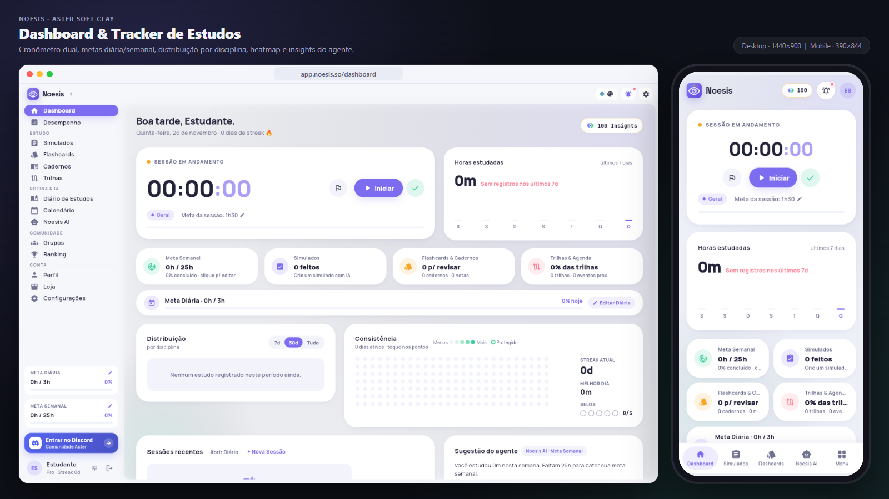
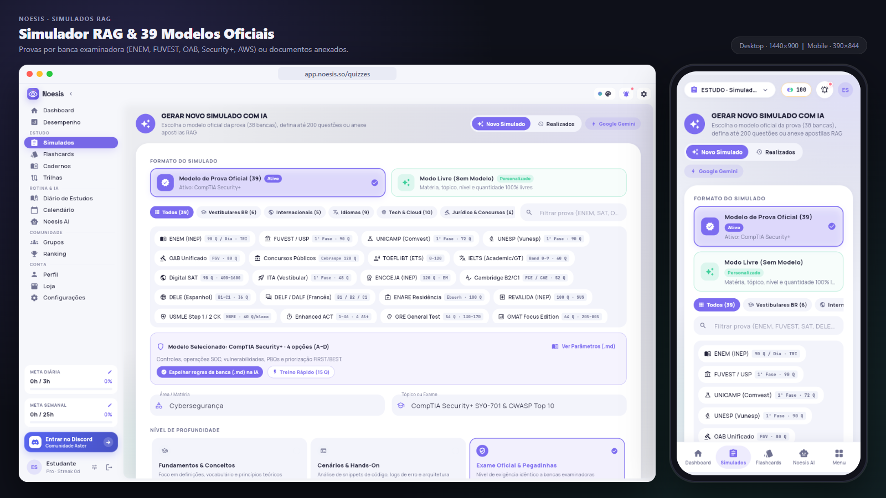
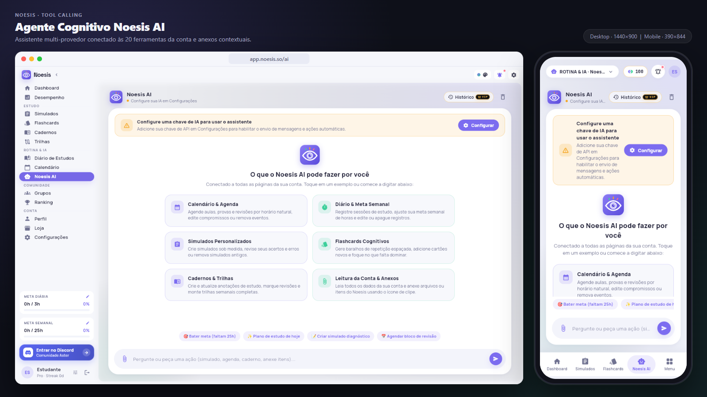
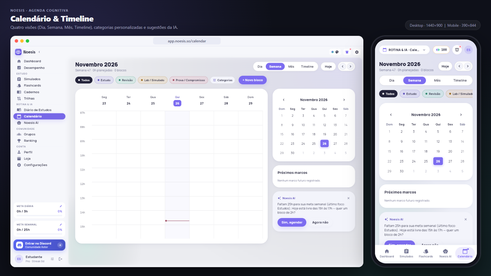
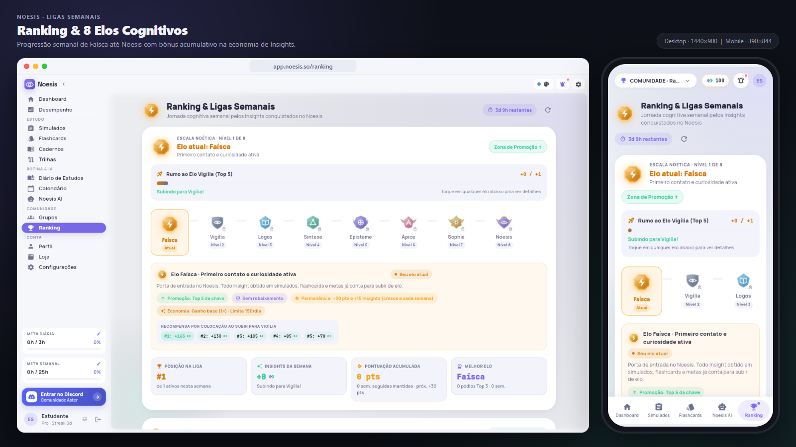
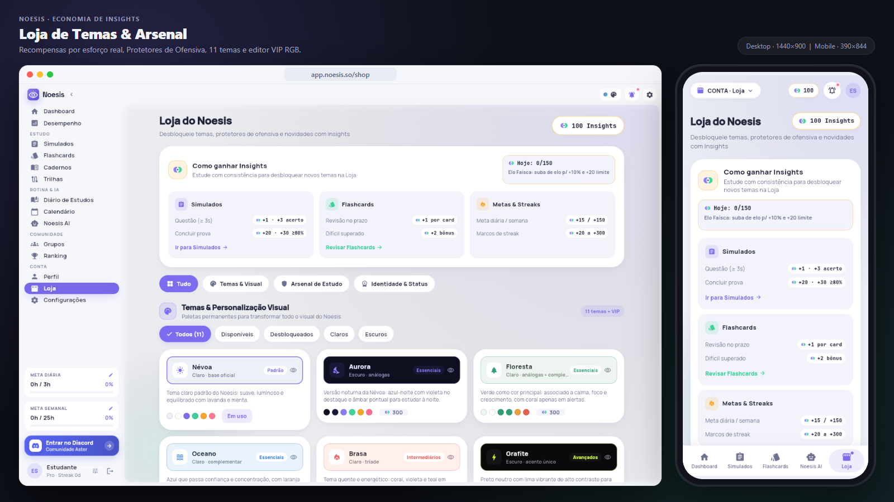
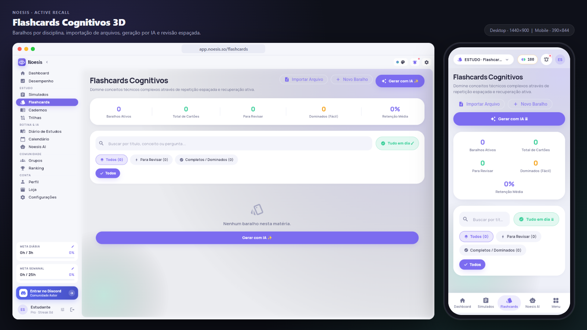
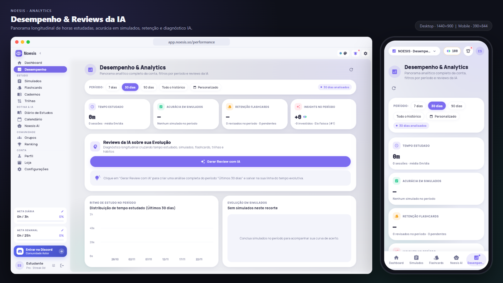
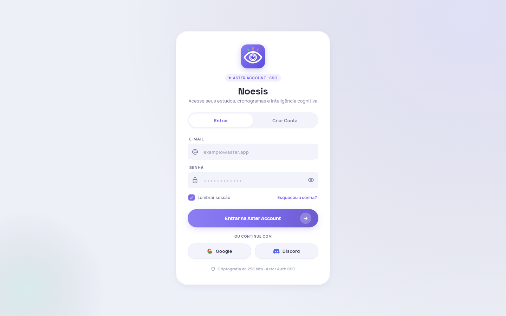

<div align="center">


# 🏛️ Noesis — Cognitive OS & AI Study Engine

**Sistema operacional cognitivo, tracker de estudos, simulador RAG, flashcards 3D e agente autônomo com IA multi-provedor do ecossistema Aster.**

[](https://flutter.dev)
[](https://dart.dev)
[](https://supabase.com)
[](https://github.com/zAstergun/Noesis/releases)
[](#-downloads-oficiais)

[📥 Downloads](#-downloads-oficiais) • [📸 Fotos](#-fotos-do-software) • [✨ Módulos](#-módulos-e-funcionalidades-14-abas) • [🤖 Noesis AI](#-motor-de-ia-e-20-ferramentas) • [🗂️ Estrutura](#-estrutura-do-repositório) • [🚀 Executar](#-como-executar-e-compilar) • [📚 Docs](#-documentação-técnica)

</div>

---

## 📦 Downloads Oficiais (`v1.0.0+1`)

Os instaladores/pacotes oficiais estão disponíveis na aba [**GitHub Releases**](https://github.com/zAstergun/Noesis/releases) e também versionados na pasta [`releases/`](releases/README.md) (mantendo `build/` ignorado pelo Git):

| Plataforma | Pacote | Versão | Tamanho | Download Direto |
| :--- | :--- | :---: | :---: | :--- |
| **Android** | APK Release (`noesis-v1.0.0-android.apk`) | `v1.0.0+1` | ~70,5 MB | [⬇️ Baixar APK](releases/android/noesis-v1.0.0-android.apk?raw=true) |
| **Windows (x64)** | Aplicativo Desktop Portátil (`.zip`) | `v1.0.0+1` | ~15,4 MB | [⬇️ Baixar Windows x64](releases/windows/noesis-v1.0.0-windows-x64.zip?raw=true) |
| **GitHub Releases** | Página oficial de lançamentos (`APKs` + `Desktop`) | `v1.0.0+1` | — | [🏷️ Abrir Releases](https://github.com/zAstergun/Noesis/releases) |

> **Como usar:**
> - **Android:** baixe `noesis-v1.0.0-android.apk` e instale no aparelho.
> - **Windows:** baixe `noesis-v1.0.0-windows-x64.zip`, extraia a pasta `Noesis-Windows-x64/` e execute `noesis.exe` mantendo os arquivos `.dll` e a pasta `data/` juntos.
> - Consulte hashes **SHA-256** e instruções completas em [`releases/README.md`](releases/README.md).

---

## 📸 Fotos do Software

Capturas reais da versão atual do **Noesis** em **Desktop (`1440×900`)** e **Mobile (`390×844`)** lado a lado, sobre o Design System **Aster Soft Clay** (com suporte a **Modo Claro**, **Dark Mode**, **10 temas desbloqueáveis** na Loja e **Tema VIP customizável RGB**).

### Dashboard & Tracker de Estudos (Desktop + Mobile)
Cronômetro dual (Stopwatch / Pomodoro), metas diária e semanal, gráficos analíticos (`fl_chart`), heatmap de consistência (`CustomPainter`) e insights do agente.



### Motor de Simulados com RAG & 39 Modelos Oficiais (Desktop + Mobile)
Geração e resolução de provas por catálogo oficial de bancas (ENEM, FUVEST, OAB, CompTIA Security+, AWS, etc.) ou documentos anexados (`.pdf`, `.txt`, `.md`, `.json`).



### Agente Cognitivo `Noesis AI` com 20 Ferramentas (Desktop + Mobile)
Assistente multi-provedor conectado a todas as abas da conta para criar simulados, baralhos, trilhas, cadernos, sessões e agendamentos via Function Calling.



### Calendário & Timeline Cognitiva (Desktop + Mobile)
Quatro modos de visualização (Dia, Semana, Mês e Timeline), categorias semânticas personalizadas e recomendações proativas de blocos pela IA.



### Ranking Semanal (8 Elos) & Loja de Insights (`✦`)
| Ranking & Ligas Semanais (Desktop + Mobile) | Loja de Temas & Arsenal (Desktop + Mobile) |
| :---: | :---: |
|  |  |

<details>
<summary>📱 Ver mais telas reais (Flashcards 3D, Desempenho & Analytics e Login SSO)</summary>

### Flashcards Cognitivos 3D (Desktop + Mobile)


### Desempenho & Reviews da IA (Desktop + Mobile)


### Aster Account SSO (Login)


</details>

---

## ✨ Módulos e Funcionalidades (14 Abas)

O aplicativo organiza todo o fluxo de aprendizado em **14 abas lazy-loaded** com shell adaptativo (**Sidebar + Barra Nativa Desktop** no Windows/Web larga e **Bottom Bar + Menu Hub** no Mobile):

| Seção | Módulo | Destaques |
| :--- | :--- | :--- |
| **Principal** | **Dashboard** (`Tracker`) | Cronômetro Stopwatch/Pomodoro via `ValueNotifier`, metas diária e semanal, distribuição por matéria e heatmap diário |
| **Principal** | **Desempenho** | Métricas de evolução, acurácia em simulados e análise de ritmo de estudo |
| **Estudo** | **Simulados** | Gerador RAG por tema, arquivo anexado ou catálogo oficial em [`exemplos_simulados/`](exemplos_simulados/README.md) |
| **Estudo** | **Flashcards** | Baralhos organizados, importação de arquivos, gerador IA e modo de revisão 3D flip espaçada |
| **Estudo** | **Cadernos** | Resumos e anotações estruturadas sincronizadas por disciplina |
| **Estudo** | **Trilhas** (`Roadmaps`) | Planos de aprendizado em etapas com prazo estimado por objetivo |
| **Rotina & IA** | **Diário de Estudos** | Registro detalhado e histórico editável de sessões estudadas |
| **Rotina & IA** | **Calendário** | Vistas Dia/Semana/Mês/Timeline, categorias personalizadas e blocos sugeridos pela IA |
| **Rotina & IA** | **Noesis AI** | Chat Markdown com histórico persistente, anexos contextuais e 20 ferramentas autônomas |
| **Comunidade** | **Grupos** | Grupos de estudo colaborativos com escopo e acompanhamento compartilhado |
| **Comunidade** | **Ranking** | Ligas semanais com **8 Elos** (`Faísca` → `Vigília` → `Logos` → `Síntese` → `Episteme` → `Ápice` → `Sophia` → `Noesis`) |
| **Conta** | **Perfil** | Conexões sociais, conquistas, avatar, cosméticos e perfil público |
| **Conta** | **Loja** | Economia de **Insights (`✦`)**, Protetores de Ofensiva, 10 temas e privilégios VIP (Editor RGB) |
| **Conta** | **Configurações** | 7 provedores de IA com benchmark de latência (ms), tema Claro/Escuro e **15 idiomas** |

### Diferenciais Técnicos
- **🖥️ Janela Nativa Desktop (Windows)**: Barra superior integrada (`DesktopTopBar` + `DesktopWindowService` via `MethodChannel`) com arrasto, minimizar, maximizar/restaurar, fechar e sincronia automática com o Dark Mode.
- **🔐 Aster Account SSO & Modo Visitante**: Login via Supabase Auth (Email/Senha + OAuth Google, GitHub, Discord e Apple com loopback) e **Modo Visitante (`Guest Mode`)** completo em memória para uso offline imediato.
- **🗄️ Backend Compartilhado Seguro**: **9 tabelas `noesis_*`** com **Row Level Security (RLS)** no Supabase (`noesis_sessions`, `noesis_calendar_events`, `noesis_documents`, `noesis_quizzes`, `noesis_flashcard_decks`, `noesis_study_notebooks`, `noesis_roadmaps`, `noesis_study_groups`, `noesis_insight_ledger`) integradas a `public.profiles`.
- **⚡ Performance Web & WasmGC**: Fontes locais `.ttf` offline (`allowRuntimeFetching = false`), `RepaintBoundary`, `CustomPainter` no heatmap, `Offstage` + `TickerMode` entre abas e isolates (`compute`) para parsing RAG.

---

## 🤖 Motor de IA e 20 Ferramentas

O `GeminiService` funciona como roteador multi-provedor (**Google Gemini**, **OpenAI**, **Anthropic**, **xAI · Grok**, **DeepSeek**, **OpenRouter** e **Custom REST**), enquanto `NoesisAgentTools` expõe **20 ferramentas** de leitura e escrita na conta do usuário:

- **Inspeção:** `inspect_account_data`
- **Calendário:** `schedule_calendar_event`, `update_calendar_event`, `delete_calendar_event`
- **Diário & Metas:** `log_study_session`, `update_study_session`, `delete_study_session`, `set_weekly_goal`, `set_daily_goal`
- **Simulados & Flashcards:** `create_quiz`, `delete_quiz`, `create_flashcards`, `update_flashcard_deck`, `delete_flashcard_deck`
- **Cadernos & Trilhas:** `create_notebook_or_note`, `update_notebook_or_note`, `delete_notebook_or_note`, `create_roadmap`, `update_roadmap`, `delete_roadmap`

---

## 🗂️ Estrutura do Repositório

```text
Noesis/
├── android/                  # Projeto nativo Android
├── ios/                      # Projeto nativo iOS
├── web/                      # Configuração PWA, CanvasKit e WasmGC
├── windows/                  # Runner nativo C++ Windows Desktop (barra integrada)
├── assets/
│   ├── fonts/                # 10 fontes locais TTF (Manrope, JetBrainsMono, SpaceGrotesk)
│   └── images/               # Logotipo e ativos SVG (logo.svg, insight.svg)
├── docs/
│   ├── screenshots/          # Fotos oficiais do software exibidas no README
│   ├── ARQUITETURA.md        # Arquitetura técnica e esquema PostgreSQL/Supabase
│   └── PERFORMANCE_REPORT.md # Auditoria de performance Web e WasmGC
├── exemplos_simulados/       # Catálogo de simulados e exames por área
├── lib/
│   ├── core/                 # Serviços base (Supabase, Multi-AI, Agent Tools, Shop, Desktop, TTS)
│   ├── features/             # 17 domínios feature-first (landing, tracker, quizzes, flashcards, ranking, etc.)
│   ├── widgets/              # Componentes reutilizáveis (DesktopTopBar, Logo, VIP RGB Editor, etc.)
│   └── main.dart             # Ponto de entrada e shell responsivo de 14 abas
├── releases/                 # Binários oficiais prontos para download (APK & Windows ZIP)
│   ├── android/
│   ├── windows/
│   └── README.md
├── scripts/                  # Utilitários de empacotamento de release
│   └── package_releases.ps1
├── supabase/                 # Migrations SQL versionadas, políticas RLS e documentação do schema
│   ├── migrations/
│   └── README.md
├── test/                     # Suíte de testes unitários, widget e E2E (Tiers 1–4)
├── PROJECT_CONTEXT.md        # Documento mestre de contexto para IAs e devs
└── pubspec.yaml              # Dependências e declaração de assets Flutter
```

---

## 🚀 Como Executar e Compilar

### Pré-requisitos
- **Flutter SDK** `3.50+` / **Dart SDK** `3.14+`

### Desenvolvimento
```powershell
# Instalar dependências
flutter pub get

# Executar na Web (Chrome)
flutter run -d chrome

# Executar no Windows Desktop (.exe nativo)
flutter run -d windows

# Executar no Android (dispositivo/emulador conectado)
flutter run -d android
```

### Build de Produção, Testes & Empacotamento
```powershell
# Análise estática e suíte de testes
flutter analyze
flutter test

# Gerar builds de produção
flutter build apk --release
flutter build windows --release
flutter build web --release
flutter build web --release --wasm

# Atualizar os arquivos da pasta releases/
.\scripts\package_releases.ps1 -Version "1.0.0"
```

---

## 📚 Documentação Técnica

- 👉 **[PROJECT_CONTEXT.md](PROJECT_CONTEXT.md)** — Documento mestre com os 14 módulos, 9 tabelas `noesis_*`, Economia de Insights, Ranking, provedores e 20 ferramentas do agente.
- 👉 **[docs/ARQUITETURA.md](docs/ARQUITETURA.md)** — Visão arquitetural inicial, topologia e tokens *Aster Soft Clay*.
- 👉 **[docs/PERFORMANCE_REPORT.md](docs/PERFORMANCE_REPORT.md)** — Relatório de auditoria e otimização Web / WebAssembly.
- 👉 **[exemplos_simulados/README.md](exemplos_simulados/README.md)** — Catálogo completo de exames e certificações suportados no simulador.
- 👉 **[releases/README.md](releases/README.md)** — Guia de download, verificação SHA-256 e instruções de instalação.
