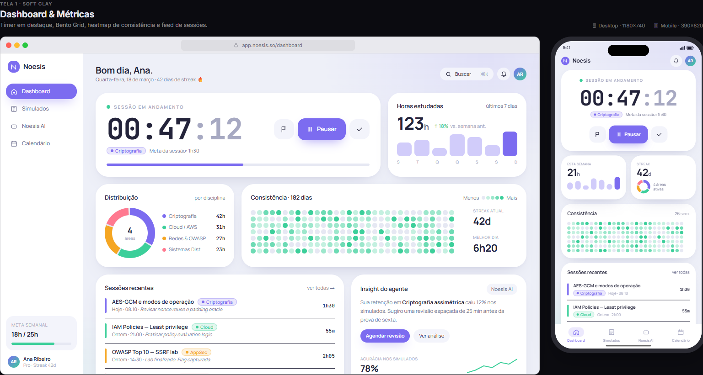
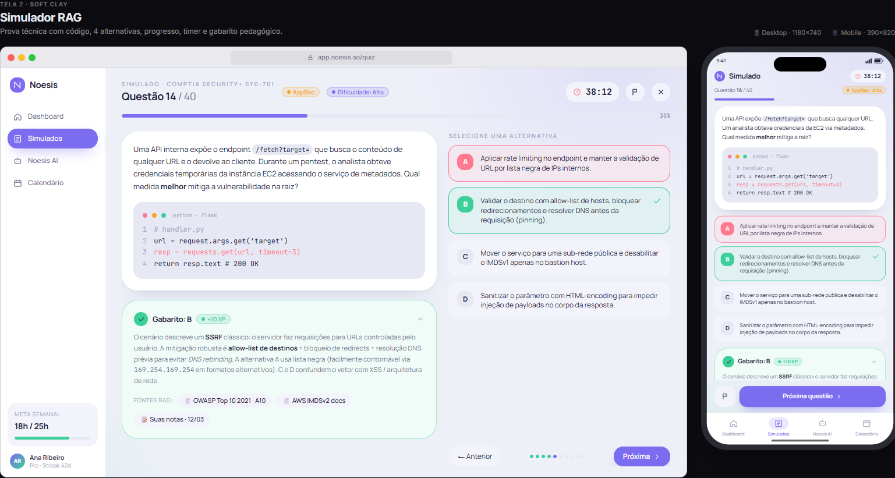
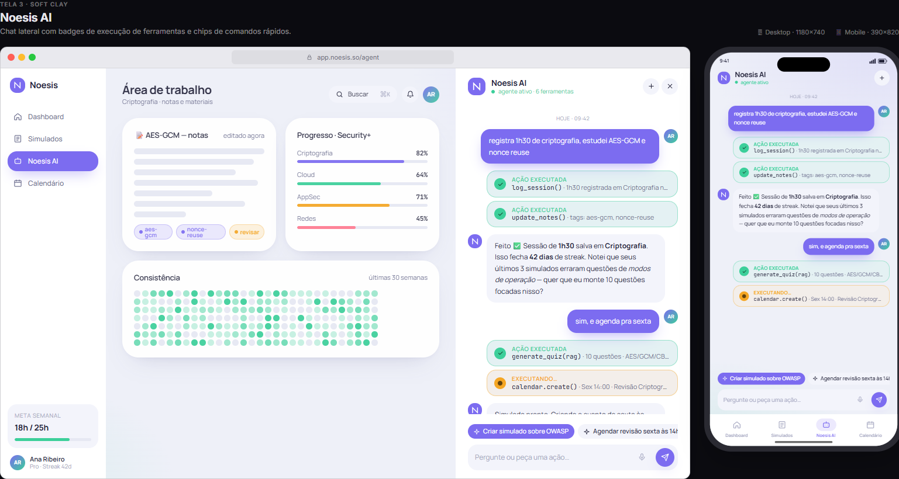
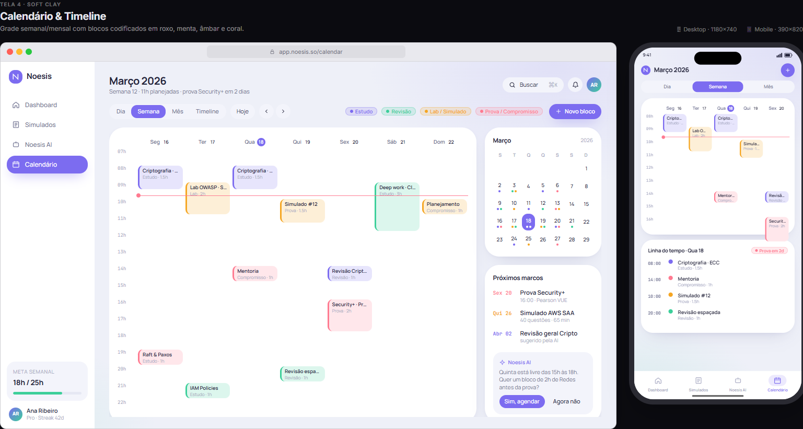
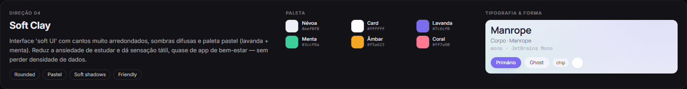

<div align="center">


# Noesis — Personal OS & AI Study Engine

**Cognitive OS & Engine de Estudos de Alta Performance do Ecossistema Aster**

[](https://flutter.dev)
[](https://dart.dev)
[](https://supabase.com)
[](#-downloads-oficiais)

[Downloads](#-downloads-oficiais) • [Fotos do Software](#-fotos-do-software) • [Funcionalidades](#-principais-funcionalidades) • [Estrutura](#-estrutura-do-repositório) • [Como Executar](#-como-executar-e-compilar) • [Documentação](#-documentação-técnica)

</div>

---

## 📦 Downloads Oficiais

Os builds prontos para uso estão versionados em [`releases/`](releases/README.md) (mantendo `build/` ignorado no Git para evitar arquivos temporários):

| Plataforma | Pacote | Versão | Tamanho | Download Direto |
| :--- | :--- | :---: | :---: | :--- |
| **Android** | APK Universal (Release) | `v1.0.0+1` | ~70,5 MB | [⬇️ Baixar `noesis-v1.0.0-android.apk`](releases/android/noesis-v1.0.0-android.apk?raw=true) |
| **Windows (x64)** | Aplicativo Desktop Portátil (`.zip`) | `v1.0.0+1` | ~15,4 MB | [⬇️ Baixar `noesis-v1.0.0-windows-x64.zip`](releases/windows/noesis-v1.0.0-windows-x64.zip?raw=true) |

> Para instruções de instalação, verificação de integridade **SHA-256** e guia de reempacotamento, consulte [`releases/README.md`](releases/README.md).

---

## 📸 Fotos do Software

Interface construída sobre o Design System **Aster Soft Clay** (suporte nativo a **Modo Claro** e **Dark Mode**, adaptada para Desktop, Web e Mobile).

### Dashboard & Tracker de Estudos
Cronômetro dual (Stopwatch/Pomodoro), métricas semanais, distribuição por disciplina, heatmap de consistência e insights do agente.



### Motor de Simulados com RAG
Geração e resolução de simulados por banca/área ou com base em documentos e provas anexadas, com blocos de código, timer e gabarito comentado.



### Agente Cognitivo (Noesis AI com Tool Calling)
Assistente multi-provedor capaz de registrar sessões de estudo, gerar simulados e agendar revisões diretamente no banco de dados.



### Calendário & Timeline Cognitiva
Visões de Dia, Semana, Mês e Timeline com categorização semântica e sugestões inteligentes de blocos de estudo.



<details>
<summary>🎨 Ver paleta e tokens do Design System Aster Soft Clay</summary>



</details>

---

## ✨ Principais Funcionalidades

- **⏱️ Tracker de Estudos & Métricas**: Cronômetro contínuo e Pomodoro, histórico de sessões, gráficos analíticos (`fl_chart`) e heatmap de consistência em `CustomPainter`.
- **📅 Calendário Integrado**: Agenda com 4 visões (Dia, Semana, Mês e Timeline), categorias por cor e criação assistida por IA.
- **🤖 Agente Noesis AI (Multi-Provedor + Tool Calling)**: Suporte a Google Gemini, OpenAI, Anthropic, DeepSeek, xAI (Grok), OpenRouter e endpoints customizados, executando ações reais via Function Calling.
- **📝 Simulados com RAG & Catálogo de Bancas**: Provas comentadas e modelos prontos para vestibulares, concursos, direito, medicina, finanças, idiomas e certificações de tecnologia (ver [`exemplos_simulados/`](exemplos_simulados/README.md)).
- **🃏 Flashcards 3D & Active Recall**: Baralhos organizados por disciplina com revisão interativa e integração com o Tracker.
- **📚 Cadernos, Roadmaps, Grupos, Ranking & Loja Insights**: Ecossistema completo de produtividade, trilhas guiadas, estudo colaborativo e gamificação.
- **🔐 Aster Account SSO & Modo Visitante**: Autenticação via Supabase (`auth.users` + `public.profiles` + tabelas `noesis_*` com RLS) e modo offline/visitante totalmente funcional.

---

## 🗂️ Estrutura do Repositório

```text
Noesis/
├── android/                  # Projeto nativo Android
├── ios/                      # Projeto nativo iOS
├── web/                      # Configuração PWA, CanvasKit e WasmGC
├── windows/                  # Runner nativo C++ Windows Desktop
├── assets/
│   ├── fonts/                # Fontes locais (Manrope, JetBrainsMono, SpaceGrotesk)
│   └── images/               # Logotipo e ativos gráficos SVG
├── docs/
│   ├── ARQUITETURA.md        # Arquitetura técnica e esquema PostgreSQL/Supabase
│   ├── PERFORMANCE_REPORT.md # Auditoria de performance Web e WasmGC
│   └── screenshots/          # Capturas oficiais do software
├── exemplos_simulados/       # Base de simulados e editais por categoria
├── lib/
│   ├── core/                 # Serviços base (Supabase, Multi-AI, tema, economia, desktop)
│   ├── features/             # Módulos por domínio (tracker, quizzes, calendar, ai_agent, etc.)
│   ├── widgets/              # Componentes reutilizáveis da UI
│   └── main.dart             # Ponto de entrada e shell responsivo
├── releases/                 # Downloads oficiais (APK Android e Windows Desktop .zip)
│   ├── android/
│   ├── windows/
│   └── README.md
├── scripts/                  # Scripts de empacotamento e automação
│   └── package_releases.ps1
├── test/                     # Suíte de testes unitários, widget e E2E
├── PROJECT_CONTEXT.md        # Documento mestre de contexto para IAs e devs
└── pubspec.yaml              # Dependências e assets do Flutter
```

---

## 🚀 Como Executar e Compilar

### Desenvolvimento
```powershell
# Instalar dependências
flutter pub get

# Executar na Web (Chrome)
flutter run -d chrome

# Executar no Windows Desktop
flutter run -d windows

# Executar no Android (dispositivo/emulador conectado)
flutter run -d android
```

### Build de Produção & Empacotamento
```powershell
# Gerar APK de release e executável Windows
flutter build apk --release
flutter build windows --release

# Gerar Web com WebAssembly (WasmGC)
flutter build web --release --wasm

# Atualizar os pacotes em releases/
.\scripts\package_releases.ps1 -Version "1.0.0"
```

### Testes
```powershell
flutter test
```

---

## 📚 Documentação Técnica

- 👉 **[PROJECT_CONTEXT.md](PROJECT_CONTEXT.md)** — Contexto completo do sistema, regras do ecossistema Aster, arquitetura multi-provedor e esquema de banco.
- 👉 **[docs/ARQUITETURA.md](docs/ARQUITETURA.md)** — Visão arquitetural, esquema SQL (`noesis_*`) e tokens do Design System.
- 👉 **[docs/PERFORMANCE_REPORT.md](docs/PERFORMANCE_REPORT.md)** — Relatório de auditoria e otimização Web/WasmGC.
- 👉 **[exemplos_simulados/README.md](exemplos_simulados/README.md)** — Catálogo de áreas e exames suportados no simulador.
